<div align="center">

# EcoHub 3D

### Plataforma digital para sustentabilidade, cooperação e inovação no ecossistema da impressão 3D

[](https://laravel.com)
[](https://www.php.net)
[](https://www.postgresql.org)
[](https://react.dev)
[](https://vite.dev)
[](frontend/src/styles/tokens.css)
[](https://www.figma.com/design/vZYI6VEfTDdlgzbk1mgYis)


*Programa Institucional de Iniciação em Desenvolvimento Tecnológico e Inovação (PIBITI)*<br>
**Universidade Estadual de Ponta Grossa (UEPG)**

</div>

---

## Resumo

O **EcoHub 3D** é uma plataforma web que reúne, num único ambiente, os atores do ecossistema da impressão 3D: *makers*, laboratórios universitários, escolas públicas, empresas e profissionais da área. O foco é a **economia circular**: a plataforma organiza o ciclo **doação → coleta → reciclagem → novo filamento → nova peça** e emite, para cada lote reciclado, um **QR Code** que mostra a origem do material e o laudo de qualidade.

Em paralelo, o sistema oferece:
- um canal de **pedidos de escolas públicas** atendidos por laboratórios e voluntários;
- um **banco de currículos e vagas** em manufatura aditiva;
- um **repositório de projetos** com arquivos STL/3MF validados e curadoria;
- um **portal de notícias** e um **ranking de impacto** com pontos e selos.

A solução é uma API REST em Laravel com PostgreSQL, consumida por uma SPA em React com design system próprio em CSS. O controle de acesso é feito por perfis (RBAC). Empresas, escolas e laboratórios só atuam depois que um moderador verifica o CNPJ/INEP, e as regras de negócio críticas são reforçadas no próprio banco de dados.

**Palavras-chave:** impressão 3D · economia circular · manufatura aditiva · reciclagem de polímeros · rastreabilidade · plataforma digital · inovação social.

---

## Sumário

1. [Contexto e justificativa](#1-contexto-e-justificativa)
2. [Objetivos](#2-objetivos)
3. [Funcionalidades](#3-funcionalidades)
4. [Perfis de usuário e permissões](#4-perfis-de-usuário-e-permissões)
5. [Arquitetura](#5-arquitetura)
6. [Fluxos de negócio](#6-fluxos-de-negócio)
7. [Telas e navegação](#7-telas-e-navegação)
8. [Diagramas UML e modelo de dados (Figma)](#8-diagramas-uml-e-modelo-de-dados-figma)
9. [Tecnologias](#9-tecnologias)
10. [Como executar](#10-como-executar)
11. [Testes e qualidade](#11-testes-e-qualidade)
12. [Principais endpoints da API](#12-principais-endpoints-da-api)
13. [Segurança](#13-segurança)
14. [Estrutura do repositório](#14-estrutura-do-repositório)
15. [Ferramentas de desenvolvimento (MCP e Skills)](#15-ferramentas-de-desenvolvimento-mcp-e-skills)
16. [Metodologia de desenvolvimento](#16-metodologia-de-desenvolvimento)
17. [Resultados e trabalhos futuros](#17-resultados-e-trabalhos-futuros)
18. [Equipe e créditos](#18-equipe-e-créditos)

---

## 1. Contexto e justificativa

A impressão 3D se difundiu em universidades, escolas e entre *makers* independentes, mas gera resíduos que raramente voltam à cadeia produtiva: peças com falha, suportes, carretéis e sobras de filamento. Ao mesmo tempo:
- grupos de pesquisa em polímeros conseguem reprocessar esse material;
- escolas públicas têm demanda por formação em fabricação digital, mas não têm a quem recorrer.

As soluções existentes atendem demandas isoladas: serviços de impressão, redes sociais, repositórios de modelos ou cursos. **Nenhuma reúne esses atores num único ambiente** nem registra a origem do material reciclado. O EcoHub 3D atua como agente integrador:
- aproxima o conhecimento acadêmico das demandas da sociedade;
- dá credibilidade científica ao filamento reciclado, com rastreabilidade e laudos de qualidade;
- gera indicadores de impacto socioambiental úteis para editais de fomento (FINEP, CNPq).

## 2. Objetivos

**Objetivo geral:** desenvolver uma plataforma digital que conecte os atores do ecossistema de impressão 3D e organize o ciclo de vida dos materiais segundo os princípios da economia circular.

**Objetivos específicos:**
- Permitir que *makers* doem resíduos e que laboratórios os coletem para reciclagem.
- Rastrear cada lote de filamento reciclado, da doação ao laudo técnico, por QR Code.
- Viabilizar pedidos de escolas públicas (treinamento, modelagem, scanner 3D, impressão) atendidos por laboratórios e voluntários.
- Manter um banco de currículos e vagas especializado em manufatura aditiva.
- Oferecer um repositório de projetos com arquivos validados, licenças claras e curadoria de segurança.
- Estimular a participação com gamificação (pontos, selos e ranking).

## 3. Funcionalidades

Situação em relação ao documento de requisitos (*Adapta One*, out/2026):

| Módulo | Situação | O que funciona |
| :--- | :---: | :--- |
| **1. Doação de makers** | ✅ | Mural de doações (resíduo ou filamento) com polímero, peso, cor, cidade e fotos. O doador edita enquanto a doação está disponível e acompanha as coletas. |
| **2. Receptores e reciclagem** | ✅ | Laboratórios verificados solicitam a coleta; o doador aceita (reservando a doação) ou recusa; a data é combinada e o laboratório conclui com o peso real. Com as coletas concluídas, o laboratório cria **lotes de filamento**, registra a linha do tempo (triturado, extrudado...) e **emite o laudo** com PDF, que aprova ou reprova o lote. |
| **3. Repositório de projetos** | ✅ | Projetos com área (saúde, educação, agro, acessibilidade), licença Creative Commons e **arquivos STL/3MF validados** (volume e dimensões calculados). Imagens de capa, moderação, denúncias e download por link assinado. |
| **4. Pedidos de escolas públicas** | ✅ | Escolas e empresas verificadas abrem chamados com tipo de serviço e prazo. Laboratórios e makers escolhem o **local de atendimento** (na escola, no espaço do prestador ou remoto), aceitam e concluem. O contato é liberado só aos envolvidos. |
| **5. Banco de currículos** e vagas | ✅ | Instituições verificadas publicam vagas com modalidade, contrato, nível, UF, faixa salarial e habilidades, avaliam candidatos e encerram vagas; pessoas físicas mantêm currículo (especialidades, portfólio, disponibilidade, visibilidade no banco) e se candidatam; contratantes buscam no banco de currículos por especialidade, UF, modalidade e disponibilidade. |
| **6. Hub de conexão** | ⏳ | Planejado (mural de demandas e ofertas). |
| Notícias | ✅ | Portal editorial com destaques, temas, reações e comentários; publicação com revisão. |
| Rastreabilidade por QR Code | ✅ | Página pública `/rastreio/:codigo`: origem agregada, linha do tempo, laudos e o PDF, **sem dados pessoais**. |
| Controle de qualidade | ✅ | Laudo com diâmetro, tolerância, ovalidade, tração, alongamento, faixa de temperatura e umidade. |
| Gamificação | ✅ | 50 pontos por chamado concluído, 30 por coleta concluída (laboratório), 15 por doação entregue (doador), 20 por projeto aprovado; selos e ranking. |
| Diretório de empresas | ✅ | Página de empresas, escolas, laboratórios e estabelecimentos verificados, com filtro por tipo e números de participação na rede. |
| Curadoria e verificação | ✅ | Moderação de notícias e projetos com histórico, denúncias e **verificação de CNPJ/INEP** com consulta à Receita (BrasilAPI). |

## 4. Perfis de usuário e permissões

No cadastro, cada usuário escolhe um **tipo**: pessoa física, empresa, escola, laboratório ou estabelecimento (loja, oficina ou clínica com CNPJ).
- Pessoas físicas podem se declarar **maker/voluntário**.
- Empresas, escolas, laboratórios e estabelecimentos começam **pendentes** até um moderador verificar o CNPJ (e o INEP, no caso das escolas).
- Moderadores têm um **papel administrativo** à parte.

A partir disso, a API calcula os perfis de acesso em um único método, `Usuario::temPerfil()`:

| Perfil | Quem tem | O que libera |
| :--- | :--- | :--- |
| `solicitante` | escola, empresa ou estabelecimento verificados | abrir e acompanhar chamados |
| `prestador` | laboratório verificado; pessoa física maker | ver chamados abertos, **escolher o local** e aceitar; concluir |
| `contratante` | empresa, escola, laboratório ou estabelecimento verificados | publicar vagas, avaliar candidatos, consultar currículos |
| `candidato` | pessoa física | candidatar-se a vagas e manter currículo |
| `publicador` | instituição verificada ou moderador | publicar notícias (com revisão) |
| `receptor` | laboratório verificado | solicitar coletas, criar lotes, registrar eventos e emitir laudos |
| `moderador` | papel moderador ou admin | moderar conteúdo, resolver denúncias, verificar instituições |

| Ação | Pessoa física | Maker | Empresa | Escola | Estabelecimento | Laboratório | Moderador | Visitante |
| :--- | :-: | :-: | :-: | :-: | :-: | :-: | :-: | :-: |
| Abrir chamado | | | ✅ | ✅ | ✅ | | (vê todos) | |
| Ver abertos, escolher local e aceitar | | ✅ | | | | ✅ | | |
| Publicar vaga, ver candidatos e buscar no banco de currículos | | | ✅ | ✅ | ✅ | ✅ | | |
| Candidatar-se / manter currículo | ✅ | ✅ | | | | | | |
| Publicar notícia (com revisão) | | | ✅ | ✅ | ✅ | ✅ | ✅ (direto) | |
| Enviar projeto 3D (com revisão) | ✅ | ✅ | ✅ | ✅ | ✅ | ✅ | ✅ | |
| Registrar doação de peças e filamento | ✅ | ✅ | ✅ | ✅ | ✅ | ✅ | | |
| Solicitar coleta (receptor homologado), criar lote, emitir laudo | | | | | | ✅ | | |
| Moderar e verificar instituições | | | | | | | ✅ | |
| Diretório de empresas | ✅ | ✅ | ✅ | ✅ | ✅ | ✅ | ✅ | |
| Ler conteúdo publicado, rastreio e ranking | ✅ | ✅ | ✅ | ✅ | ✅ | ✅ | ✅ | ✅ (rastreio) |

As regras são aplicadas em quatro camadas:
1. **Interface:** `pode(...perfis)` e `RequirePerfil` escondem o que o usuário não pode fazer (experiência de uso, não segurança).
2. **Middleware `perfil`:** responde 403 antes de chegar ao controller.
3. **Policies:** regras sobre o registro (dono, status, "moderador não modera o próprio").
4. **Banco de dados:** constraints CHECK, índices únicos parciais e triggers.

## 5. Arquitetura

O sistema é organizado em cinco camadas, e cada uma só conversa com a camada seguinte:

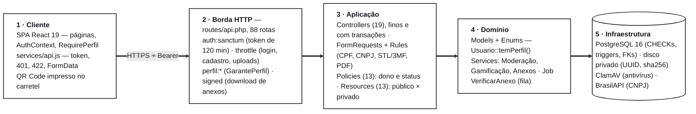

O caminho de uma requisição protegida, com todas as barreiras, por exemplo quando um laboratório aceita um chamado:

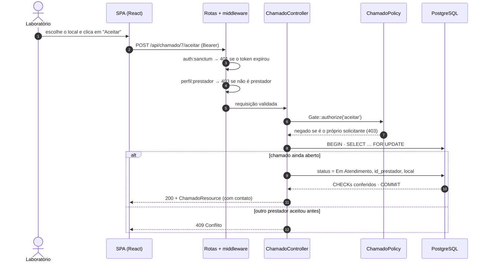

- **Backend:** API REST *stateless* com tokens Laravel Sanctum (expiram em 120 min e são revogados no logout). A validação fica em FormRequests que espelham as constraints do banco, as respostas são padronizadas por API Resources e as regras transversais ficam em Services. Mensagens em português (`lang/pt_BR`).
- **Frontend:** SPA com rotas carregadas sob demanda e um cliente HTTP único, que trata o token, a sessão expirada, os erros de validação por campo e os uploads. O design system é escrito em CSS puro (tokens, componentes e layout).
- **Banco de dados:** PostgreSQL. As migrations de linha de base reproduzem fielmente o esquema que já estava em uso e são ignoradas em bancos existentes; as evoluções preservam os dados legados.

## 6. Fluxos de negócio

### 6.1 Economia circular: da doação ao QR Code

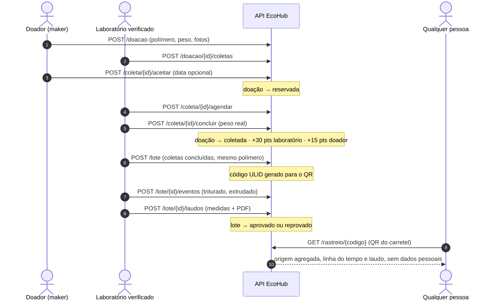

### 6.2 Estados de cada entidade

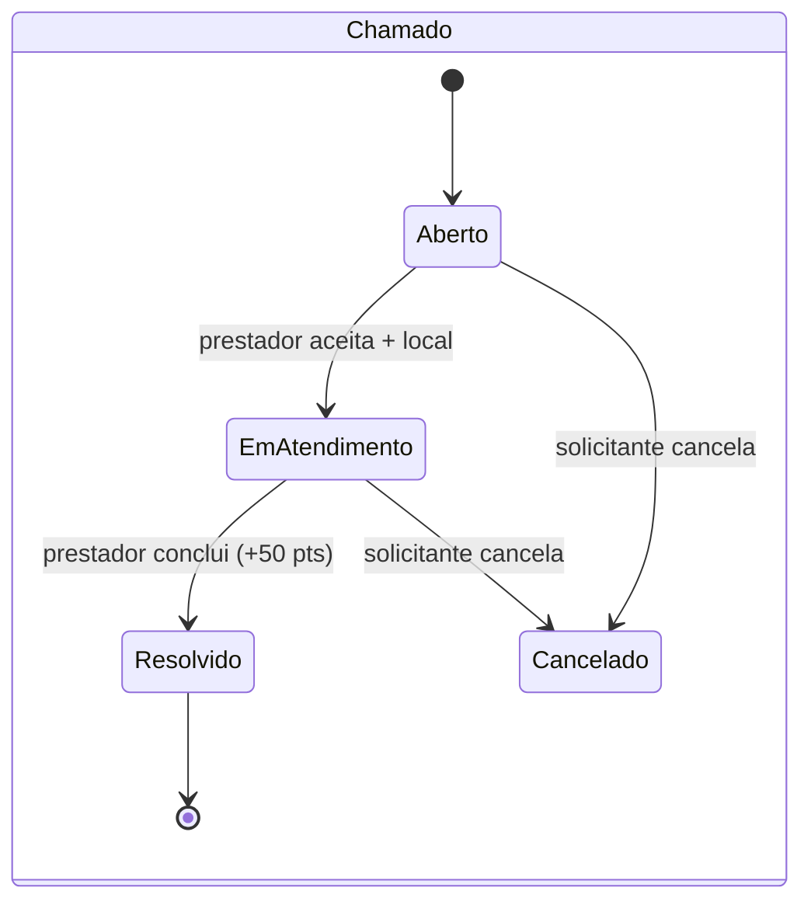

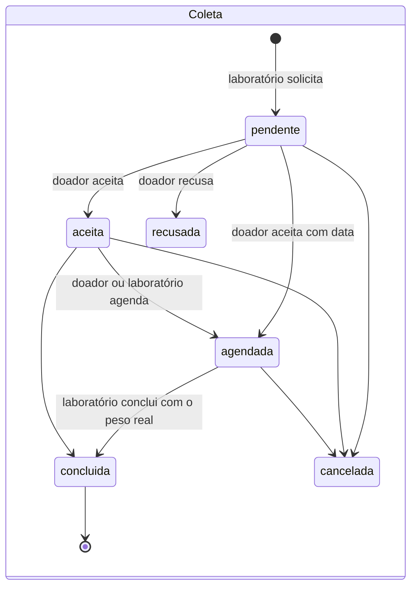

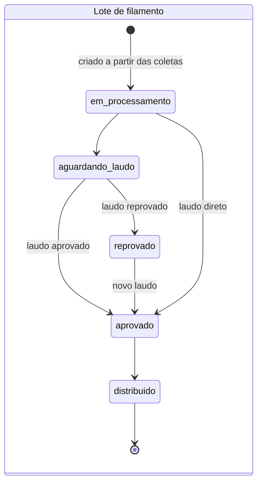

### 6.3 Verificação de instituições

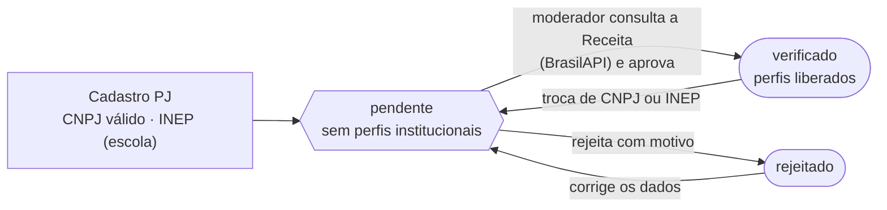

## 7. Telas e navegação

O mapa de navegação abaixo foi pensado para **prototipar no Figma sem erros**: cada nó é um frame, cada seta é uma interação e o cadeado indica o perfil exigido (a mesma regra da API). As telas sem cadeado exigem apenas login, exceto as da área "Público".

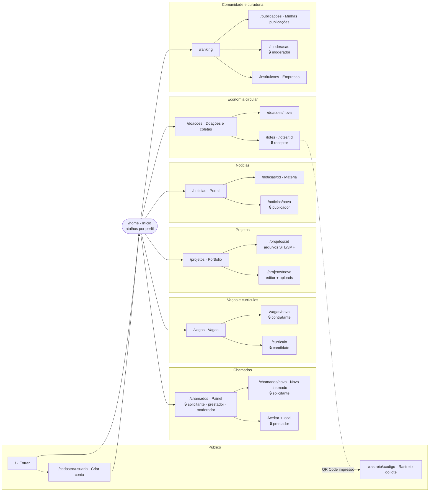

Cada tela, a regra de visibilidade e o lugar das capturas (desktop e mobile) estão em **[`SCREENS.md`](SCREENS.md)**. Referências visuais, todas lidas diretamente dos arquivos de design do Figma:

| Área | Arquivo do Figma | Frame |
| :--- | :--- | :--- |
| Início | [Modern Product Launch](https://www.figma.com/design/LGUJtWnvKBIbWzRrLwYUS8) | `1:29` |
| Entrar e criar conta | [Register Page for Web](https://www.figma.com/design/RkvaW8JJjgGQ1vhk6dNoNT) | `1:2` |
| Portal de notícias e matéria | [New York Times News Portal](https://www.figma.com/design/pmQejtfTEUKhDgbK4PvcPI) | `1:131` |
| Vitrine e detalhe de projetos | [Personal Portfolio Website Template](https://www.figma.com/design/W9vaSi2rB9IZaf2ty9y4Bn) | `7:191`, `7:291` |
| Navegação e rodapé | [Footers](https://www.figma.com/design/g8QB6OEHbZd5qr9k2k0fc4) | `113:7361` |
| Chamados, Doações, Empresas, Vagas e todos os formulários de registro | [Website Templates — Squarespace](https://www.figma.com/design/2BKD8TGc4woMAtnmbZkz5f) + estrutura de painel do Mockfit | `19:2115` |

Todo o visual é feito em **CSS puro** (`frontend/src/styles/`), com tokens e um arquivo por página. Os movimentos (transição de página, revelar ao rolar, hovers, carrosséis com setas/pontos/autoplay/arrastar, contadores, barras que crescem e dropzones reativas) estão em `styles/animacoes.css`, `components/Carrossel.jsx`, `components/RevelarAoRolar.jsx` e `components/ui.jsx`, e são desligados com `prefers-reduced-motion`.

## 8. Diagramas UML e modelo de dados (Figma)

Os diagramas foram desenhados no Figma, no arquivo **[EcoHub 3D — Diagramas UML e Banco de Dados](https://www.figma.com/design/vZYI6VEfTDdlgzbk1mgYis)**, que tem quatro páginas e usa variáveis de cor iguais aos tokens do frontend. As exportações ficam em [`docs/diagramas/`](docs/diagramas/).

Para os templates oficiais do projeto no Figma/FigJam ([User Flow](https://www.figma.com/board/pR035aNZzQtJ6MFpvtuvF0), [UML Diagrams](https://www.figma.com/board/eqWkYTSakFSjIw95uzFJ5A) e [Database Diagram Builder](https://www.figma.com/design/KSFC7l25Nu0mVDmt6ODcJo)), o conteúdo já vem estruturado em [`docs/DIAGRAMAS_FIGMA.md`](docs/DIAGRAMAS_FIGMA.md): nós e conectores do fluxo com as regras de RBAC, classes e multiplicidades, e as 21 tabelas com colunas, chaves e restrições geradas do banco real.

### 8.1 Modelo de dados

21 tabelas de domínio com PK, FK, tipos e relacionamentos, gerado a partir do banco real (`information_schema`). As cores indicam o módulo.

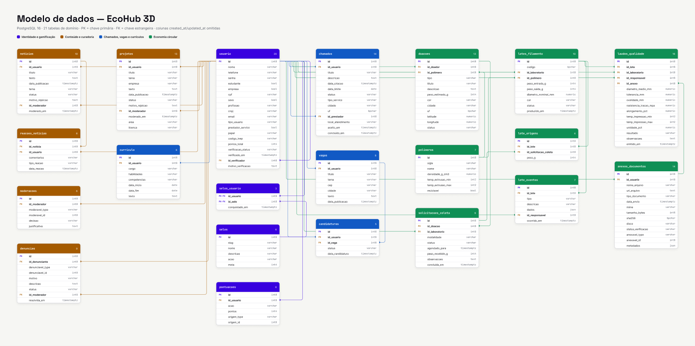

Resumo das relações principais:

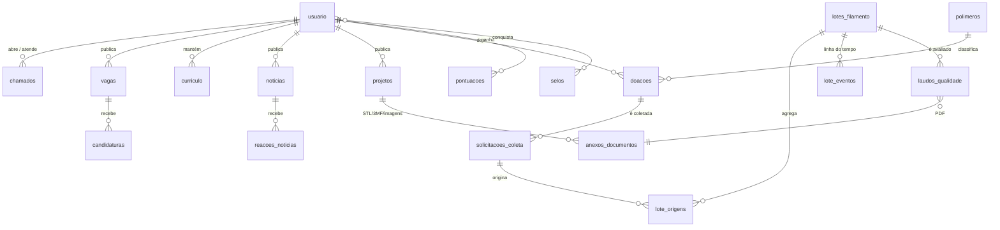

### 8.2 Diagrama de classes

Models Eloquent com atributos e operações de domínio, multiplicidades, composições (◆) e a faixa de enums, interfaces, serviços e middleware.

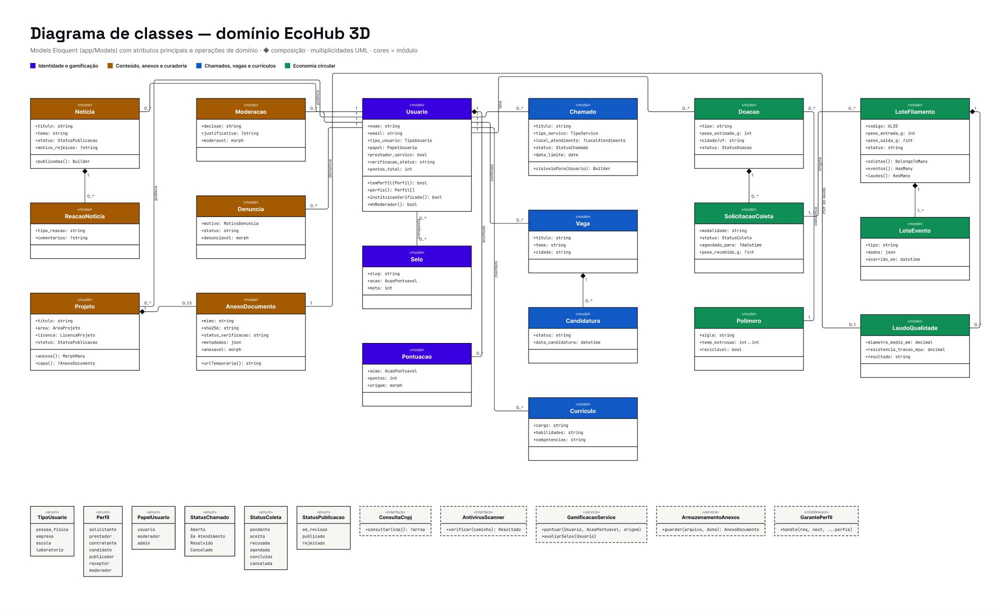

### 8.3 Casos de uso por perfil

Atores abstratos (Usuário autenticado, Instituição verificada) generalizam os concretos. Os casos de uso ficam do lado de quem os executa: pessoa física à esquerda, instituições à direita e os compartilhados no centro.

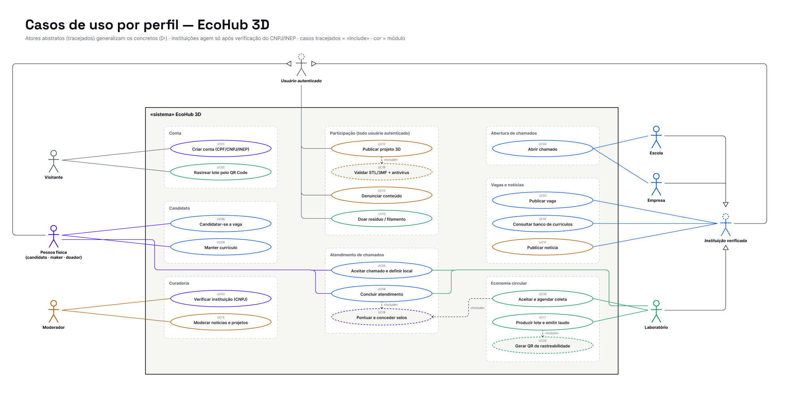

### 8.4 Mapa de telas e jornadas

Os 22 frames do protótipo, com rota, guarda de acesso e navegação, e as quatro jornadas principais (chamado escolar, resíduo → filamento, vaga e projeto aberto).

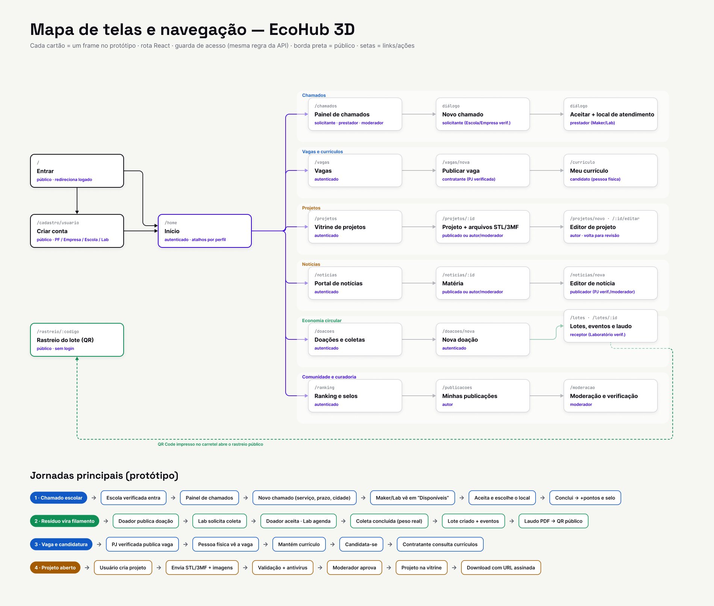

## 9. Tecnologias

| Camada | Tecnologias |
| :--- | :--- |
| Backend | PHP 8.4, Laravel 13, Laravel Sanctum 4, Pest 4, Laravel Pint |
| Banco de dados | PostgreSQL 16 (produção e CI), SQLite (testes rápidos) |
| Frontend | React 19, React Router 7, Vite 7, **CSS puro** (design system com tokens), lucide-react, qrcode, Vitest + Testing Library |
| Arquivos | Validação própria de STL/3MF/PDF, GD (WebP), ClamAV (antivírus, opcional), filas do Laravel |
| Integrações | BrasilAPI (consulta de CNPJ) |
| Qualidade | GitHub Actions (Pint, Pest em PostgreSQL e SQLite, Vitest, build), Playwright (validação visual das telas em 1440, 820 e 390 px) |
| Design e gestão | Figma (diagramas, mapa de telas e referências visuais), Notion (documentação e Kanban) |

## 10. Como executar

### Passo a passo rápido (banco novo)

```bash
# 1. Bancos (PostgreSQL rodando, usuário com permissão de criar banco)
createdb ecohub3d          # desenvolvimento (DB_DATABASE do .env.example)
createdb ecohub_test       # testes contra PostgreSQL

# 2. API
cd backend
composer install
cp .env.example .env       # ajuste DB_USERNAME e DB_PASSWORD
php artisan key:generate
php artisan migrate --seed
php artisan serve          # http://localhost:8000  (terminal 1)
php artisan queue:work     # fila de verificação de anexos (terminal 2)

# 3. Frontend
cd ../frontend
npm ci
cp .env.example .env       # VITE_API_URL=http://localhost:8000/api
npm run dev                # http://localhost:5173  (terminal 3)

# 4. Conferir
cd ../backend && php artisan test && cd ../frontend && npm test -- --run
```

Entre em `http://localhost:5173` com um dos usuários de demonstração abaixo (senha `Senha@123`). As seções seguintes detalham cada passo.

### Pré-requisitos

- PHP **8.4+** com as extensões `pdo_pgsql`, `mbstring`, `zip` e `gd`
- Composer 2
- Node.js 20+
- PostgreSQL 14+

### Backend

```bash
cd backend
composer install
cp .env.example .env          # ajuste DB_DATABASE, DB_USERNAME e DB_PASSWORD
php artisan key:generate
php artisan migrate --seed    # cria o esquema completo e os dados de demonstração
php artisan serve             # http://localhost:8000
php artisan queue:work        # (outro terminal) verificação de anexos em fila
```

> **Banco já existente (criado pelo script DDL original).** Rode só `php artisan migrate`, sem `--seed`.
> - As migrations de linha de base detectam as tabelas existentes e são ignoradas; as seguintes adicionam colunas, constraints e tabelas novas **sem apagar dados**.
> - Empresas, escolas e laboratórios já cadastrados ficam como **verificados**, para não perderem acesso.
> - Faça um backup antes (`pg_dump`).
> - Usuários sem e-mail precisam ter o e-mail preenchido para conseguir entrar.
> - **Não rode `migrate:rollback`/`migrate:fresh` nesse banco:** isso apagaria as tabelas legadas.

Antivírus (opcional em desenvolvimento): defina `ANTIVIRUS_DRIVER=clamav` no `.env` e suba o ClamAV com `docker run -d -p 3310:3310 clamav/clamav:stable`. Com o padrão `nenhum`, os anexos ficam com verificação "pendente".

### Frontend

```bash
cd frontend
npm install
cp .env.example .env          # VITE_API_URL=http://localhost:8000/api
npm run dev                   # http://localhost:5173
```

### Usuários de demonstração

Criados pelo `--seed`, todos com a senha `Senha@123`:

| Perfil | E-mail | O que testar |
| :--- | :--- | :--- |
| Escola (verificada) | `escola@ecohub3d.test` | Abrir e acompanhar chamados, publicar vaga |
| Maker/voluntário | `maker@ecohub3d.test` | Aceitar e concluir chamados, doar resíduo, enviar projeto |
| Laboratório (verificado) | `laboratorio@ecohub3d.test` | Solicitar coletas, criar lote, registrar eventos, emitir laudo |
| Empresa (verificada) | `empresa@ecohub3d.test` | Publicar vagas, avaliar candidatos, consultar currículos |
| Estudante | `estudante@ecohub3d.test` | Candidatar-se a vagas, currículo |
| Moderador | `moderador@ecohub3d.test` | Moderar notícias e projetos, denúncias, **verificar instituições** |
| Empresa pendente | `pendente@ecohub3d.test` | Ver uma conta institucional ainda sem perfis |
| Estabelecimento (verificado) | `estabelecimento@ecohub3d.test` | Abrir chamados como oficina/loja |
| Profissionais | `carla@ecohub3d.test` · `joao@ecohub3d.test` | Currículos no banco (um deles oculto) |

Para ver o QR Code sem login, abra `http://localhost:5173/rastreio/01JECHB3DDEMNTE00000000001` (lote de demonstração).

## 11. Testes e qualidade

```bash
# Backend — 163 testes (826 asserções), de feature e unitários: autenticação, perfis (RBAC),
# verificação, estabelecimentos, uploads STL/3MF/PDF, economia circular, rastreio,
# gamificação, moderação, vagas e banco de currículos, CPF/CNPJ, volume de malhas
cd backend && php artisan test

# Mesmos testes contra PostgreSQL (constraints e triggers reais)
DB_CONNECTION=pgsql DB_DATABASE=ecohub_test php artisan test

# Frontend — 54 testes (Vitest + Testing Library, API compatível com Jest): cliente da API,
# sessão, rotas por perfil, formulários de registro, cadastro, vagas, carrossel, componentes
cd frontend && npm test -- --run
```

O pipeline de integração contínua (`.github/workflows/ci.yml`) roda a cada *pull request*:
- verificação de estilo (Pint);
- testes do backend em **PostgreSQL 16 e SQLite**;
- testes do frontend;
- build de produção.

Os testes de upload usam arquivos gerados na hora (`tests/Support/ArquivosDeTeste.php`): cubo STL binário e ASCII, 3MF, *zip bomb* e PDF com JavaScript.

## 12. Principais endpoints da API

| Recurso | Endpoints | Acesso |
| :--- | :--- | :--- |
| Autenticação | `POST /api/usuario` · `POST /api/login` · `POST /api/logout` · `GET/PATCH/DELETE /api/usuario/me` | público (com limite) / autenticado |
| Chamados | `GET/POST /api/chamado` · `GET /api/chamado/opcoes` · `POST /api/chamado/{id}/aceitar` · `/concluir` · `/cancelar` | solicitante, prestador, moderador |
| Vagas e candidaturas | `GET /api/vaga?q=&tema=&modalidade=&tipo_contrato=&nivel=&uf=&cidade=` · `GET /api/vaga/opcoes` · `POST/PATCH/DELETE /api/vaga` · `POST /api/vaga/{id}/encerrar` · `GET /api/vaga/{id}/candidaturas` · `GET/POST/PATCH/DELETE /api/candidatura` | público (mural) / contratante / candidato |
| Currículos | `GET /api/curriculo?q=&especialidade=&uf=&modalidade=&disponibilidade=` (banco) · `GET /api/curriculo/meus` · `POST/PATCH/DELETE /api/curriculo` | banco: contratante · próprio: candidato |
| Instituições | `GET /api/instituicoes?tipo=&q=&ordem=` · `GET /api/instituicoes/{id}` | autenticado |
| Notícias | `GET/POST /api/noticia` · `POST /api/noticia/{id}/moderacao` · `PUT/DELETE /api/noticia/{id}/reacao` | autenticado / publicador / moderador |
| Projetos e anexos | `GET/POST /api/projeto?area=&licenca=&q=` · `POST /api/projeto/{id}/anexos` · `GET /api/anexo/{id}/link` · `GET /api/anexo/{id}/arquivo` (assinado) | autenticado / autor / moderador |
| Doações | `GET/POST/PUT/DELETE /api/doacao` · `GET /api/doacao/minhas` · `POST /api/doacao/{id}/fotos` | autenticado (edição: doador) |
| Coletas | `POST /api/doacao/{id}/coletas` · `GET /api/coleta` · `POST /api/coleta/{id}/aceitar` · `/recusar` · `/agendar` · `/concluir` · `/cancelar` | receptor / doador |
| Lotes e laudos | `GET/POST /api/lote` · `PATCH /api/lote/{id}` · `POST /api/lote/{id}/eventos` · `POST /api/lote/{id}/laudos` | receptor |
| Verificação | `GET /api/moderacao/instituicoes` · `GET …/{id}/cnpj` · `POST …/{id}/verificacao` | moderador |
| Denúncias | `POST /api/denuncia` · `GET /api/denuncia` · `POST /api/denuncia/{id}/resolver` | autenticado / moderador |
| Públicos | `GET /api/rastreio/{codigo}` · `GET /api/ranking` · `GET /api/polimeros` | público |

São 88 rotas no total. As listas são paginadas (`?per_page=`, máximo 100) no formato `{ data, links, meta }`. Os códigos de resposta seguem o padrão:
- **401:** sem login ("Faça login para continuar.");
- **403:** perfil ou registro não permitido;
- **404:** "Registro não encontrado.";
- **409:** conflito, como um chamado já aceito;
- **422:** validação, com erros por campo em português.

## 13. Segurança

| Tema | Como é tratado |
| :--- | :--- |
| Acesso | Token Sanctum de 120 min, revogado no logout; middleware de perfil + Policy por registro; verificação de instituições antes de liberar perfis. |
| Escalada de privilégio | `tipo_usuario` e `papel` imutáveis pela API; CHECKs no banco; troca de CNPJ/INEP volta a conta para "pendente". |
| Abuso | Limites de tentativas no login (5/min por e-mail+IP), cadastro (6/min), rastreio (60/min) e uploads (30/min). |
| Uploads | Conteúdo conferido (não só a extensão): STL pela contagem de triângulos, 3MF contra *zip bomb* e XXE, PDF sem JavaScript, imagens re-codificadas em WebP (sem EXIF/GPS). Disco privado, nome UUID, `sha256`, antivírus em fila e download por URL assinada e temporária. |
| Dados pessoais | Resources separam perfil público e privado; contato só entre as partes depois do aceite; rastreio sem dados de doadores; CPF/CNPJ com dígitos verificadores conferidos. |
| Injeção e XSS | Só Eloquent com *bindings*; React escapa a saída; textos guardados como texto puro. |
| Concorrência | Aceite de chamado com `lockForUpdate`; UNIQUEs para candidatura, reação, pontuação, denúncia e solicitação de coleta ativa. |

Detalhes e recomendações para produção: [`docs/DIAGNOSTICO_E_ROADMAP.md`](docs/DIAGNOSTICO_E_ROADMAP.md), seção 7.

## 14. Estrutura do repositório

```
IC/
├── backend/                       # API Laravel
│   ├── app/
│   │   ├── Contracts/             # AntivirusScanner, ConsultaCnpj (implementação trocável)
│   │   ├── Enums/                 # tipos de usuário, perfis, status, áreas, licenças
│   │   ├── Http/Controllers/      # um controller por recurso
│   │   ├── Http/Middleware/       # GarantePerfil (RBAC por rota)
│   │   ├── Http/Requests/         # validação espelhando as constraints do banco
│   │   ├── Http/Resources/        # contrato JSON (público × privado)
│   │   ├── Jobs/                  # VerificarAnexo (antivírus)
│   │   ├── Models/                # Eloquent (+ Concerns/Moderavel)
│   │   ├── Policies/              # regras por registro
│   │   ├── Rules/                 # Cpf, Cnpj, ModeloImpressao3d, LaudoPdf
│   │   ├── Services/              # moderação, gamificação, BrasilAPI, Anexos/
│   │   └── Support/               # Documento (CPF/CNPJ), Arquivos/ (STL, 3MF, PDF)
│   ├── database/
│   │   ├── migrations/            # linha de base do DDL legado + evoluções
│   │   ├── factories/             # estados por perfil (escola, laboratório, pendente...)
│   │   └── seeders/               # dados de demonstração em português
│   ├── lang/pt_BR/                # mensagens da API
│   ├── routes/api.php             # rotas agrupadas por perfil
│   └── tests/Feature/Api/         # testes de API (Pest)
├── frontend/                      # SPA React
│   └── src/
│       ├── assets/ilustracoes/    # ilustrações das telas de entrada
│       ├── components/            # ui.jsx, Nav, Footer, AppLayout, RegistroLayout, RequirePerfil...
│       ├── contexts/              # AuthContext (sessão e permissões)
│       ├── pages/                 # Chamados, Vagas/, Projetos/, Noticias/, Economia/...
│       ├── services/api.js        # cliente HTTP único
│       ├── styles/                # tokens, base, componentes, layout e pages/*.css
│       └── utils/formatar.js      # rótulos e formatação em pt-BR
├── docs/
│   ├── DIAGNOSTICO_E_ROADMAP.md   # relatório técnico: funções, banco, RBAC, segurança, roadmap
│   ├── FERRAMENTAS_E_MCP.md       # instalação de MCPs, Skills, hooks e extensões
│   ├── DIAGRAMAS_FIGMA.md         # conteúdo pronto para os templates de User Flow, UML e DER
│   └── diagramas/                 # exportações do Figma
├── SCREENS.md                     # índice das telas, RBAC da interface e galeria de capturas
├── .mcp.json                      # servidores MCP do projeto (Laravel Boost, PostgreSQL, Playwright, Figma)
└── .github/workflows/ci.yml       # integração contínua
```

## 15. Ferramentas de desenvolvimento (MCP e Skills)

O repositório já traz um [`.mcp.json`](.mcp.json) com os servidores usados no desenvolvimento assistido pelo Claude Code:

| Servidor | Uso |
| :--- | :--- |
| **Laravel Boost** | Esquema do banco, rotas, último erro e documentação da versão exata do Laravel |
| **PostgreSQL** (somente leitura) | Consultar tabelas, constraints e planos de execução antes de propor migrations |
| **Playwright** | Validar cada tela com cada perfil de demonstração |
| **Figma** | Ler os diagramas e as referências visuais |

Os comandos de instalação, o papel de banco somente leitura, os *hooks* de formatação, as Skills sugeridas e as extensões do VS Code estão em [`docs/FERRAMENTAS_E_MCP.md`](docs/FERRAMENTAS_E_MCP.md).

## 16. Metodologia de desenvolvimento

- **Levantamento de requisitos** com os orientadores e o documento *Requisitos Plataforma Eco Hub 3D*: 6 módulos e 11 funcionalidades sugeridas.
- **Modelagem** no Figma: modelo de dados, classes, casos de uso e mapa de telas com jornadas. Acompanhamento das tarefas em Kanban no Notion.
- **Desenvolvimento incremental** por módulo, com *commits* atômicos no padrão *Conventional Commits* (`feat`, `fix`, `refactor`, `perf`, `ci`, `docs`).
- **Banco como fonte de verdade das regras críticas:** constraints CHECK e triggers no PostgreSQL, espelhados na validação da API.
- **Verificação contínua:** testes automatizados para cada regra de permissão e fluxo, executados em PostgreSQL e SQLite. Validação visual de todas as telas, com cada perfil, em navegador real (desktop e celular).

## 17. Resultados e trabalhos futuros

**Resultados alcançados:**
- API com 88 rotas, sete perfis de acesso, cinco tipos de conta, verificação de instituições e 217 testes automatizados (163 no backend, 54 no frontend).
- Cinco dos seis módulos do documento de requisitos com banco, API e tela.
- Ciclo completo de economia circular: doação → coleta → lote → laudo → QR Code público.
- Uploads de STL, 3MF, imagens e PDFs com validação por conteúdo e antivírus.
- Esquema PostgreSQL versionado, compatível com o banco original e ampliado com rastreabilidade, laudos, gamificação, moderação e anexos.
- Frontend com 22 telas (incluindo os cinco formulários de registro) clonadas dos arquivos do Figma, design system próprio em CSS e movimento acessível.

**Próximas etapas** (detalhadas em [`docs/DIAGNOSTICO_E_ROADMAP.md`](docs/DIAGNOSTICO_E_ROADMAP.md), seção 6.2):
1. Polímeros aceitos e capacidade por laboratório; geolocalização por CEP.
2. Mapa interativo (PostGIS) e **Hub de conexão** (mural de demandas e ofertas).
3. Notificações (aceite, coleta agendada, laudo emitido) e visualizador 3D dos projetos.
4. Marketplace com orçamento automático e painel de impacto socioambiental.
5. API versionada (`/api/v1`) com OpenAPI; implantação em servidor (domínio, HTTPS, backup, ClamAV e fila) e testes com usuários reais.

## 18. Equipe e créditos

| Papel | Nome |
| :--- | :--- |
| Bolsista | Luiz Felipe Dias de Araujo — Engenharia de Computação |
| Orientador | Prof. Benjamim de Melo Carvalho |
| Coorientador | Prof. Dr. Maurício Zadra Pacheco |

**Projeto vinculado a:** *Processamento, Caracterização e Desenvolvimento de Sistemas Poliméricos Sintéticos e Naturais*.
**Programa:** PIBITI — Universidade Estadual de Ponta Grossa. **Vigência da bolsa:** setembro de 2025 a agosto de 2026.

**Referências visuais:** arquivos da Comunidade do Figma *Register Page for Web*, *Modern Product Launch*, *New York Times News Portal*, *Personal Portfolio Website Template*, *Web Footer Templates*, *Website Templates (Squarespace)* e *Mockfit*. As ilustrações das telas de entrada vêm do arquivo *Register Page for Web*, publicado na Comunidade do Figma, e os créditos são dos autores originais.

### Como citar

> ARAUJO, L. F. D.; CARVALHO, B. M.; PACHECO, M. Z. **EcoHub 3D: plataforma digital para sustentabilidade, cooperação e inovação no ecossistema da impressão 3D.** Ponta Grossa: Universidade Estadual de Ponta Grossa, Programa PIBITI, 2026. Software. Disponível em: https://github.com/LuizFelipeDias/IC.

### Licença

Software desenvolvido para fins acadêmicos no âmbito do PIBITI/UEPG. Uso, reprodução e distribuição dependem de autorização dos autores e da instituição.

---

<div align="center">

Desenvolvido no Programa PIBITI — Universidade Estadual de Ponta Grossa

</div>
