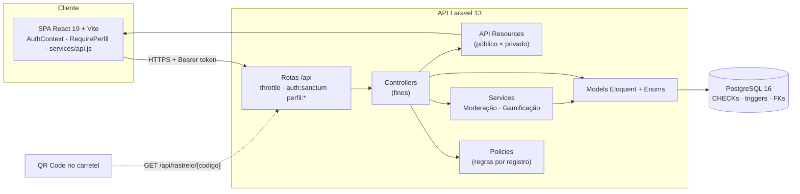
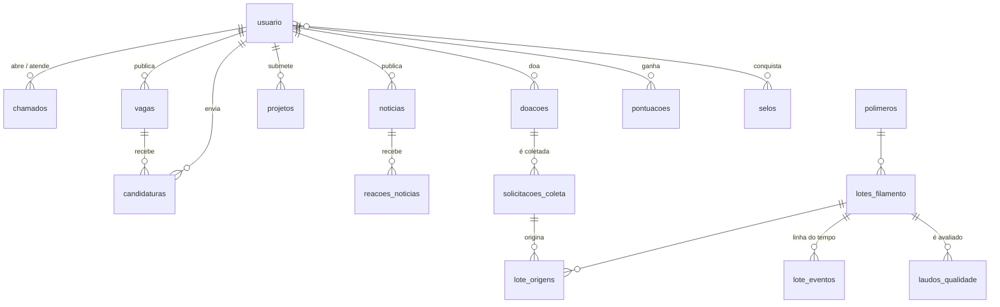

<div align="center">

# EcoHub 3D

### Plataforma digital para sustentabilidade, cooperação e inovação no ecossistema da impressão 3D

[](https://laravel.com)
[](https://www.php.net)
[](https://www.postgresql.org)
[](https://react.dev)
[](https://vite.dev)
[](https://tailwindcss.com)


*Programa Institucional de Iniciação em Desenvolvimento Tecnológico e Inovação (PIBITI)*<br>
**Universidade Estadual de Ponta Grossa (UEPG)**

</div>

---

## Resumo

O **EcoHub 3D** é uma plataforma web que integra, num único ambiente, os atores do ecossistema de impressão 3D: *makers*, laboratórios universitários, escolas públicas, empresas e profissionais da área. O foco é a **economia circular**. A plataforma organiza o ciclo **doação → coleta → reciclagem → novo filamento → nova peça** e, em paralelo, oferece:
- um canal de pedidos de escolas públicas atendidos por voluntários;
- um banco de currículos e vagas;
- um repositório de projetos com curadoria;
- a rastreabilidade do material reciclado por QR Code.

O sistema é uma API REST em Laravel com PostgreSQL, consumida por uma SPA em React. O controle de acesso é feito por perfis (RBAC) e as regras de negócio são reforçadas no próprio banco de dados.

**Palavras-chave:** impressão 3D · economia circular · manufatura aditiva · reciclagem de polímeros · plataforma digital · inovação social.

---

## Sumário

1. [Contexto e justificativa](#1-contexto-e-justificativa)
2. [Objetivos](#2-objetivos)
3. [Funcionalidades](#3-funcionalidades)
4. [Perfis de usuário e permissões](#4-perfis-de-usuário-e-permissões)
5. [Arquitetura](#5-arquitetura)
6. [Modelo de dados](#6-modelo-de-dados)
7. [Tecnologias](#7-tecnologias)
8. [Como executar](#8-como-executar)
9. [Testes e qualidade](#9-testes-e-qualidade)
10. [Principais endpoints da API](#10-principais-endpoints-da-api)
11. [Estrutura do repositório](#11-estrutura-do-repositório)
12. [Metodologia de desenvolvimento](#12-metodologia-de-desenvolvimento)
13. [Resultados e trabalhos futuros](#13-resultados-e-trabalhos-futuros)
14. [Equipe e créditos](#14-equipe-e-créditos)

---

## 1. Contexto e justificativa

A impressão 3D se difundiu em universidades, escolas e entre *makers* independentes, mas gera resíduos (peças com falha, suportes, carretéis e sobras de filamento) que raramente voltam à cadeia produtiva. Ao mesmo tempo, grupos de pesquisa em polímeros conseguem reprocessar esse material, e escolas públicas têm demanda por formação em fabricação digital sem ter a quem recorrer.

As soluções existentes atendem demandas isoladas: serviços de impressão, redes sociais, repositórios de modelos ou cursos. **Nenhuma reúne esses atores num único ambiente** nem registra a origem do material reciclado. O EcoHub 3D atua como agente integrador:
- aproxima o conhecimento acadêmico das demandas da sociedade;
- dá credibilidade científica ao filamento reciclado, com rastreabilidade e laudos de qualidade;
- gera indicadores de impacto socioambiental úteis para editais de fomento (FINEP, CNPq).

## 2. Objetivos

**Objetivo geral:** desenvolver uma plataforma digital que conecte os atores do ecossistema de impressão 3D e organize o ciclo de vida dos materiais segundo os princípios da economia circular.

**Objetivos específicos:**
- Permitir que *makers* doem resíduos e que laboratórios os recebam para reciclagem.
- Rastrear cada lote de filamento reciclado, da doação ao laudo técnico, por QR Code.
- Viabilizar pedidos de escolas públicas (treinamento, modelagem, scanner 3D, impressão) atendidos por laboratórios e voluntários.
- Manter um banco de currículos e vagas especializado em manufatura aditiva.
- Oferecer um repositório de projetos com licenças claras e curadoria de segurança.
- Estimular a participação com gamificação (pontos, selos e ranking).

## 3. Funcionalidades

Status em relação ao documento de requisitos (*Adapta One*, out/2026):

| Módulo | Situação | O que já funciona |
| :--- | :---: | :--- |
| **Pedidos de escolas públicas** (chamados) | ✅ Implementado | Escolas e empresas abrem chamados com tipo de serviço e prazo. Laboratórios e makers veem os chamados abertos, escolhem o local de atendimento (na escola, no laboratório ou remoto), aceitam e concluem. O contato é liberado só aos envolvidos. |
| **Banco de currículos** e vagas | ✅ Implementado | Instituições publicam vagas e avaliam candidatos; pessoas físicas cadastram currículo e se candidatam. Empresas consultam o banco de currículos. |
| **Repositório de projetos** | 🟡 Parcial | Submissão com área (saúde, educação, agro, acessibilidade) e licença Creative Commons, moderação, denúncias e filtros. *Pendente:* arquivos STL/3MF. |
| **Receptores e reciclagem** | 🟡 Parcial | Banco pronto: solicitações de coleta, lotes, eventos e laudos. Página pública de rastreio do lote. *Pendente:* telas e endpoints de cadastro. |
| **Doação de makers** | 🟡 Parcial | Banco pronto: doações com polímero, peso, cor e localização. *Pendente:* telas e endpoints. |
| **Hub de conexão** | ⏳ Planejado | Mural de demandas e ofertas (ver roadmap). |
| Notícias | ✅ Implementado | Publicação por instituições, moderação, reações e comentários. |
| Rastreabilidade por QR Code | ✅ Backend | `GET /api/rastreio/{codigo}`: origem, linha do tempo e laudos, sem dados pessoais. |
| Gamificação | ✅ Backend | Pontos por chamado concluído e projeto aprovado, selos e ranking público. |
| Curadoria e segurança | ✅ Implementado | Moderação com histórico, denúncias, conteúdo só público após aprovação. |

## 4. Perfis de usuário e permissões

No cadastro, cada usuário escolhe um **tipo**: pessoa física, empresa, escola ou laboratório. Pessoas físicas podem se declarar **maker/voluntário**, e moderadores têm um **papel administrativo** à parte. A partir disso, a API calcula os perfis de acesso:

| Ação | Pessoa física | Maker/voluntário | Empresa | Escola | Laboratório | Moderador |
| :--- | :-: | :-: | :-: | :-: | :-: | :-: |
| Abrir chamados | | | ✅ | ✅ | | |
| Ver chamados abertos, escolher local e aceitar | | ✅ | | | ✅ | |
| Publicar vagas | | | ✅ | ✅ | ✅ | |
| Candidatar-se a vagas | ✅ | ✅ | | | | |
| Publicar notícias (com revisão) | | | ✅ | ✅ | ✅ | ✅ |
| Submeter projetos (com revisão) | ✅ | ✅ | ✅ | ✅ | ✅ | ✅ |
| Aprovar ou rejeitar conteúdo, resolver denúncias | | | | | | ✅ |

As regras são aplicadas em quatro camadas:
1. **Interface:** esconde o que o usuário não pode fazer.
2. **Middleware `perfil`:** responde 403 antes de chegar ao controller.
3. **Policies:** regras sobre o registro (dono, status).
4. **Banco de dados:** constraints CHECK e triggers.

A regra de cada perfil está num único método, `Usuario::temPerfil()`.

## 5. Arquitetura



- **Backend:** API REST stateless com tokens Laravel Sanctum (expiram em 120 min e são revogados no logout). Validação em FormRequests que espelham as constraints do banco; respostas padronizadas por API Resources; regras transversais em Services.
- **Frontend:** SPA com rotas carregadas sob demanda, cliente HTTP único (token, sessão expirada e erros de validação por campo) e componentes que mostram apenas as ações permitidas ao perfil.
- **Banco de dados:** PostgreSQL. O esquema que já estava em uso é reproduzido fielmente pelas migrations de linha de base, que são ignoradas em bancos existentes; as evoluções preservam os dados legados.

## 6. Modelo de dados

São 21 tabelas de domínio. O núcleo do fluxo de economia circular e dos chamados:



Todas as tabelas, constraints e decisões de modelagem estão documentadas em [`docs/DIAGNOSTICO_E_ROADMAP.md`](docs/DIAGNOSTICO_E_ROADMAP.md) (seção 2).

## 7. Tecnologias

| Camada | Tecnologias |
| :--- | :--- |
| Backend | PHP 8.4, Laravel 13, Laravel Sanctum 4, Pest 4, Laravel Pint |
| Banco de dados | PostgreSQL 16 (produção e CI), SQLite (testes rápidos) |
| Frontend | React 19, React Router 7, Vite 7, Tailwind CSS 3, Vitest + Testing Library |
| Qualidade | GitHub Actions (Pint, Pest em PostgreSQL e SQLite, Vitest, build), Playwright (validação de fluxos) |
| Design e gestão | Figma (wireframes e protótipo de alta fidelidade), Notion (documentação e Kanban) |

## 8. Como executar

### Pré-requisitos

- PHP **8.4+** com as extensões `pdo_pgsql` e `mbstring`
- Composer 2
- Node.js 20+
- PostgreSQL 14+

### Backend

```bash
cd backend
composer install
cp .env.example .env          # ajuste DB_DATABASE, DB_USERNAME e DB_PASSWORD
php artisan key:generate
php artisan migrate --seed    # cria o esquema completo e os dados de demonstração
php artisan serve             # http://localhost:8000
```

> **Banco já existente (criado pelo script DDL original).** Rode só `php artisan migrate`, sem `--seed`.
> - As migrations de linha de base detectam as tabelas existentes e são ignoradas; as seguintes adicionam colunas, constraints e tabelas novas **sem apagar dados**.
> - Faça um backup antes (`pg_dump`).
> - Usuários sem e-mail precisam ter o e-mail preenchido para conseguir entrar.
> - **Não rode `migrate:rollback`/`migrate:fresh` nesse banco:** isso apagaria as tabelas legadas.

### Frontend

```bash
cd frontend
npm install
cp .env.example .env          # VITE_API_URL=http://localhost:8000/api
npm run dev                   # http://localhost:5173
```

### Usuários de demonstração

Criados pelo `--seed`, todos com a senha `Senha@123`:

| Perfil | E-mail | O que testar |
| :--- | :--- | :--- |
| Escola | `escola@ecohub3d.test` | Abrir e acompanhar chamados |
| Maker/voluntário | `maker@ecohub3d.test` | Aceitar e concluir chamados, ranking |
| Laboratório | `laboratorio@ecohub3d.test` | Atender chamados, publicar vagas e notícias |
| Empresa | `empresa@ecohub3d.test` | Publicar vagas, avaliar candidatos, consultar currículos |
| Estudante | `estudante@ecohub3d.test` | Candidatar-se a vagas, currículo |
| Moderador | `moderador@ecohub3d.test` | Aprovar e rejeitar notícias e projetos, denúncias |

## 9. Testes e qualidade

```bash
# Backend — 73 testes de API (autenticação, permissões por perfil, fluxos, rastreio, gamificação)
cd backend && php artisan test

# Mesmos testes contra PostgreSQL (constraints e triggers reais)
DB_CONNECTION=pgsql DB_DATABASE=ecohub_test php artisan test

# Frontend — 12 testes (cliente da API, guardas de rota, permissões)
cd frontend && npm test -- --run
```

O pipeline de integração contínua (`.github/workflows/ci.yml`) roda a cada *pull request*:
- verificação de estilo (Pint);
- testes do backend em **PostgreSQL 16 e SQLite**;
- testes do frontend;
- build de produção.

## 10. Principais endpoints da API

| Recurso | Endpoints | Acesso |
| :--- | :--- | :--- |
| Autenticação | `POST /api/usuario` (cadastro) · `POST /api/login` · `POST /api/logout` · `GET/PATCH/DELETE /api/usuario/me` | público (com limite de tentativas) / autenticado |
| Chamados | `GET/POST /api/chamado` · `GET /api/chamado/opcoes` · `POST /api/chamado/{id}/aceitar` · `/concluir` · `/cancelar` | solicitante, prestador |
| Vagas | `GET /api/vaga` · `POST/PUT/DELETE /api/vaga` · `GET /api/vaga/minhas` · `GET /api/vaga/{id}/candidaturas` | público / contratante |
| Candidaturas | `GET/POST/DELETE /api/candidatura` · `PATCH /api/candidatura/{id}` | candidato / contratante |
| Currículos | `GET/POST/PUT/DELETE /api/curriculo` | autenticado |
| Notícias | `GET /api/noticia` · `POST /api/noticia` · `POST /api/noticia/{id}/moderacao` · `PUT /api/noticia/{id}/reacao` | público / publicador / moderador |
| Projetos | `GET /api/projeto?area=&licenca=&q=` · `POST /api/projeto` · `POST /api/projeto/{id}/moderacao` | público / autenticado / moderador |
| Denúncias | `POST /api/denuncia` · `GET /api/denuncia` · `POST /api/denuncia/{id}/resolver` | autenticado / moderador |
| Rastreio e ranking | `GET /api/rastreio/{codigo}` · `GET /api/ranking` | público |

As listas são paginadas (`?per_page=`, máximo 100) no formato `{ data, links, meta }`. Os códigos de resposta seguem o padrão: 401 (sem login), 403 (perfil ou registro não permitido), 409 (conflito, como chamado já aceito) e 422 (validação, com erros por campo).

## 11. Estrutura do repositório

```
IC/
├── backend/                     # API Laravel
│   ├── app/
│   │   ├── Enums/               # tipos de usuário, perfis, status, áreas, licenças
│   │   ├── Http/Controllers/    # um controller por recurso
│   │   ├── Http/Middleware/     # GarantePerfil (RBAC por rota)
│   │   ├── Http/Requests/       # validação espelhando as constraints do banco
│   │   ├── Http/Resources/      # contrato JSON (público × privado)
│   │   ├── Models/              # Eloquent (+ Concerns/Moderavel)
│   │   ├── Policies/            # regras por registro
│   │   └── Services/            # moderação e gamificação
│   ├── database/
│   │   ├── migrations/          # linha de base do DDL legado + evoluções
│   │   ├── factories/           # estados por perfil (escola, laboratório, maker...)
│   │   └── seeders/             # dados de demonstração
│   ├── routes/api.php           # rotas agrupadas por perfil
│   └── tests/Feature/Api/       # testes de API (Pest)
├── frontend/                    # SPA React
│   └── src/
│       ├── components/          # Nav, Footer, RequirePerfil
│       ├── contexts/            # AuthContext (sessão e permissões)
│       ├── services/api.js      # cliente HTTP único
│       └── pages/               # telas (Login, Cadastro, Home, Vagas, Chamados...)
├── docs/
│   └── DIAGNOSTICO_E_ROADMAP.md # relatório técnico: banco, RBAC, segurança, roadmap
└── .github/workflows/ci.yml     # integração contínua
```

## 12. Metodologia de desenvolvimento

- **Levantamento de requisitos** com os orientadores e o documento *Requisitos Plataforma Eco Hub 3D*: 6 módulos e 11 funcionalidades sugeridas.
- **Prototipação** em Figma, com wireframes e protótipo de alta fidelidade, e acompanhamento das tarefas em Kanban no Notion.
- **Desenvolvimento incremental** por módulo, com *commits* atômicos no padrão *Conventional Commits* (`feat`, `fix`, `refactor`, `perf`, `ci`, `docs`).
- **Banco como fonte de verdade das regras críticas:** constraints CHECK e triggers no PostgreSQL, espelhados na validação da API.
- **Verificação contínua:** testes automatizados para cada regra de permissão e fluxo, executados em PostgreSQL e SQLite. Validação dos fluxos de cada perfil em navegador real.

## 13. Resultados e trabalhos futuros

**Resultados alcançados:**
- API com 55 endpoints, controle de acesso por seis perfis e 73 testes automatizados.
- Esquema PostgreSQL versionado, compatível com o banco original e ampliado com rastreabilidade, laudos de qualidade, gamificação e moderação.
- Fluxo completo de chamados escola ↔ laboratório/maker, do pedido à conclusão, com pontuação do voluntário.
- Frontend integrado à API nas telas de acesso, vagas e chamados, exibindo apenas o que cada perfil pode fazer.

**Próximas etapas** (detalhadas em [`docs/DIAGNOSTICO_E_ROADMAP.md`](docs/DIAGNOSTICO_E_ROADMAP.md), seção 6.2):
1. Upload seguro de modelos STL/3MF e laudos em PDF, com verificação de assinatura e antivírus.
2. Telas e endpoints de doação, coleta, criação de lotes e emissão de laudos; página pública de rastreio com leitura de QR Code.
3. Integração das telas de notícias, projetos e currículo; mensagens em português.
4. Mapa interativo (PostGIS), Hub de conexão, marketplace com orçamento automático e painel de impacto socioambiental.
5. Implantação em servidor (domínio, HTTPS, backup) e testes com usuários reais.

## 14. Equipe e créditos

| Papel | Nome |
| :--- | :--- |
| Bolsista | Luiz Felipe Dias de Araujo — Engenharia de Computação |
| Orientador | Prof. Benjamim de Melo Carvalho |
| Coorientador | Prof. Dr. Maurício Zadra Pacheco |

**Projeto vinculado a:** *Processamento, Caracterização e Desenvolvimento de Sistemas Poliméricos Sintéticos e Naturais*.
**Programa:** PIBITI — Universidade Estadual de Ponta Grossa. **Vigência da bolsa:** setembro de 2025 a agosto de 2026.

### Como citar

> ARAUJO, L. F. D.; CARVALHO, B. M.; PACHECO, M. Z. **EcoHub 3D: plataforma digital para sustentabilidade, cooperação e inovação no ecossistema da impressão 3D.** Ponta Grossa: Universidade Estadual de Ponta Grossa, Programa PIBITI, 2026. Software. Disponível em: https://github.com/LuizFelipeDias/IC.

### Licença

Software desenvolvido para fins acadêmicos no âmbito do PIBITI/UEPG. Uso, reprodução e distribuição dependem de autorização dos autores e da instituição.

---

<div align="center">

Desenvolvido no Programa PIBITI — Universidade Estadual de Ponta Grossa

</div>
