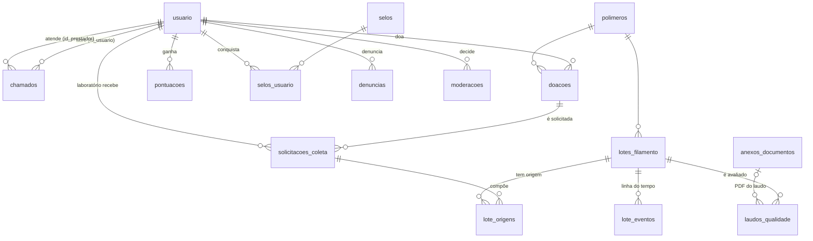

# EcoHub 3D — Relatório técnico: diagnóstico, banco de dados, permissões e roadmap

> **Versão 3 (outubro/2026).** Substitui a versão 2 (commit `7936a2c`); as versões anteriores estão no histórico do Git.
> **Artefatos analisados:** repositório (branch `Claude-Branch`), *Requisitos Plataforma Eco Hub 3d — Adapta One (outubro/2026)* e o script DDL PostgreSQL do banco em uso (`script.sql`).
> **Como foi verificado:**
> - O DDL foi carregado num PostgreSQL 16 e comparado com o esquema gerado pelas migrations (diff de `information_schema` e `pg_constraint`): **idêntico em 103 itens**.
> - As migrations novas rodaram sobre uma **cópia do banco legado com dados**, sem perda de registros.
> - A suíte de **100 testes de API** (447 asserções) passa em **PostgreSQL e SQLite**; o frontend tem 12 testes Vitest.
> - As 22 telas foram percorridas com cada perfil num navegador real (Chromium headless), em 1440 px e 390 px.
> - Os diagramas UML, o modelo de dados e o mapa de telas estão no Figma e exportados em [`docs/diagramas/`](diagramas/).

---

## Sumário executivo

| Indicador | Commit inicial (`2ba4c42`) | Versão 2 | Agora (v3) |
| :--- | :--- | :--- | :--- |
| Rotas de API | 25 (1 protegida) | 55 (44 protegidas) | **83** (70 protegidas; as públicas são login, cadastro, leituras de conteúdo publicado, polímeros, ranking, rastreio e o download assinado) |
| Controle de acesso | Inexistente | Middleware + 6 Policies + banco | Middleware `perfil` + **13 Policies** + CHECKs/triggers + **verificação de instituições** |
| Migrations | 2 | 18 | **21** |
| Testes automatizados | 0 | 73 + 12 | **100** (API, PostgreSQL e SQLite) + 12 (frontend) + CI |
| Módulos dos requisitos com API e tela | ~1,5 de 6 | 2 de 6 | **5 de 6** (falta o Hub de conexão, §2.3) |
| Uploads | — | Inexistente | STL, 3MF, imagens e PDF de laudo validados pelo **conteúdo**, disco privado, hash, antivírus em fila e URL assinada |
| Idioma da API | inglês | inglês | **português** (validação, autenticação e erros) |
| Frontend | páginas estáticas | 3 telas integradas | **22 telas** integradas, design system próprio em CSS puro |

**Riscos que continuam abertos** (detalhados em §1.4 e §7):
- usuários legados sem e-mail não conseguem fazer login;
- o antivírus vem desligado por padrão (`ANTIVIRUS_DRIVER=nenhum`); em produção é preciso subir o ClamAV e um *worker* de fila;
- não existe ainda o módulo 6 (Hub de conexão), nem mapa (PostGIS), marketplace ou painel de impacto;
- API sem versionamento (`/api/v1`) nem OpenAPI.

---

## 1. Diagnóstico do código e funções cumpridas

### 1.1 Saúde geral

| Dimensão | Avaliação | Comentário |
| :--- | :---: | :--- |
| Segurança de acesso | 🟢 | Todas as escritas exigem token e passam por perfil e por Policy; dados pessoais saem só para o próprio usuário. |
| Integridade de dados | 🟢 | CHECKs, FKs com `ON DELETE` definido, UNIQUEs e triggers no PostgreSQL; validação espelhada nos FormRequests. |
| Testabilidade | 🟢 | Factories com estados por perfil (`escola()`, `laboratorio()`, `prestador()`, `moderador()`), CI em dois bancos. |
| Consistência de API | 🟡 | Resources, paginação e 204/422/403/409 padronizados; ainda sem versionamento (`/api/v1`) nem documentação OpenAPI. |
| Frontend | 🟢 | 22 telas integradas à API, design system em CSS puro (tokens, componentes, layout), guardas de rota por perfil, *lazy loading*. |
| Cobertura dos requisitos | 🟢 | 5 de 6 módulos com banco, API e tela; ver §2.3. |

### 1.2 Funções, rotas e regras de negócio operacionais

Todas as linhas abaixo têm teste automatizado em `backend/tests/Feature/Api/`.

#### Autenticação e conta
| Rota | Acesso | Regra de negócio |
| :--- | :--- | :--- |
| `POST /api/usuario` | público, 6/min por IP | Cadastro com `tipo_usuario` (pessoa física, empresa, escola, laboratório). Deriva `estudante`/`empresa` exigidos pelo banco. Pessoa física: CPF, sexo e profissão obrigatórios. PJ: CNPJ. Escola: código INEP (8 dígitos). E-mail único, senha forte. Devolve o token (auto-login). |
| `POST /api/login` | público, 5/min por e-mail+IP | Verifica a senha com hash e emite token Sanctum de 120 min. |
| `POST /api/logout` | autenticado | Revoga o token no servidor. |
| `GET/PATCH/DELETE /api/usuario/me` | autenticado | Dados completos e **mapa de perfis** do próprio usuário. Trocar a senha exige a atual. Tipo e papel não mudam depois do cadastro. Excluir a conta remove tokens e vagas e mantém notícias e projetos sem autor. |
| `GET /api/usuario/{id}` | autenticado | Perfil público, sem CPF, CNPJ, e-mail ou telefone. |

#### Vagas e candidaturas (banco de currículos)
| Rota | Acesso | Regra |
| :--- | :--- | :--- |
| `GET /api/vaga`, `/vaga/{id}` | público | Lista paginada (`?per_page`, máx. 100). |
| `POST/PUT/DELETE /api/vaga` | **contratante** (PJ) | Autor vem do token; só o autor altera ou exclui. O trigger `trg_bloquear_estudante_vaga` repete a regra no banco. |
| `GET /api/vaga/minhas`, `/vaga/{id}/candidaturas` | contratante, dono | Painel do empregador. |
| `POST/GET/DELETE /api/candidatura` | **candidato** (PF) | Uma candidatura por vaga (`candidatura_unica`); começa "Em análise"; só o candidato desiste. |
| `PATCH /api/candidatura/{id}` | contratante, dono da vaga | Muda o status (Em análise, Aprovada, Reprovada, Cancelada). |
| `GET/POST/PUT/DELETE /api/curriculo` | autenticado | O dono gerencia; empresas consultam o banco de currículos; os demais veem só o próprio. |

#### Chamados (pedidos de escolas públicas e empresas)
| Rota | Acesso | Regra |
| :--- | :--- | :--- |
| `GET /api/chamado`, `/chamado/{id}`, `/chamado/opcoes` | solicitante, prestador, moderador | O solicitante vê os próprios; o prestador vê os **abertos** e os que atende; o moderador vê todos. `opcoes` lista tipos de serviço e **locais de atendimento**. |
| `POST/PUT/DELETE /api/chamado` | **solicitante** (escola, empresa) | Exige tipo de serviço e prazo. Editar e excluir só enquanto está "Aberto". O status nunca é alterado por PATCH. |
| `POST /api/chamado/{id}/aceitar` | **prestador** (laboratório, maker) | Exige o local de atendimento. Transação com `lockForUpdate`: um segundo aceite recebe 409. O solicitante não aceita o próprio chamado. |
| `POST /api/chamado/{id}/concluir` | prestador responsável | Marca como "Resolvido" e concede **50 pontos** e selos. |
| `POST /api/chamado/{id}/cancelar` | solicitante dono | Cancela enquanto está aberto ou em atendimento. |

O contato (e-mail e telefone) do solicitante e do prestador aparece só para os dois, depois do aceite.

#### Notícias, projetos e curadoria
| Rota | Acesso | Regra |
| :--- | :--- | :--- |
| `GET /api/noticia`, `/api/projeto` | público | Só conteúdo **publicado**. Filtros `tema`, `area`, `licenca`, `q`. O moderador pode filtrar por `status`. |
| `GET /api/{noticia|projeto}/{id}` | público / autor / moderador | Rascunho ou rejeitado: só o autor e os moderadores. |
| `GET /api/{noticia|projeto}/minhas` | autenticado | Acompanhamento da revisão. |
| `POST /api/noticia` | **publicador** (PJ ou moderador) | Nasce "em revisão" (a do moderador já nasce publicada). |
| `POST /api/projeto` | autenticado | Área e licença Creative Commons obrigatórias; nasce "em revisão". |
| `PUT/DELETE` | autor ou moderador | Edição do autor volta para revisão. |
| `POST /api/{noticia|projeto}/{id}/moderacao` | **moderador** | Aprovar ou rejeitar com motivo; registra em `moderacoes`. O moderador não modera o próprio conteúdo. Projeto aprovado dá **20 pontos** ao autor. |
| `POST /api/denuncia` · `GET /api/denuncia` · `POST /api/denuncia/{id}/resolver` | autenticado · moderador | Denúncia de conteúdo publicado (peça perigosa, licença violada...). Se procedente, o conteúdo sai do ar. |
| `PUT/DELETE /api/noticia/{id}/reacao` · `GET /api/noticia/{id}/reacoes` | autenticado · público | Uma reação por usuário (curtir, útil, inspirador) com comentário. Usa a tabela legada `reacoes_noticias`. |

#### Economia circular e engajamento
| Rota | Acesso | Regra |
| :--- | :--- | :--- |
| `GET /api/rastreio/{codigo}` | público, 60/min | Página do **QR Code**: polímero, dados técnicos, laboratório, origem agregada (doações, peso reciclado, tipos, cidades), linha do tempo e laudos, **sem dados pessoais**. Código ULID não enumerável. |
| `GET /api/ranking?tipo=` | público | Top 20 por pontos, com selos e sem contato. |
| `GET /api/polimeros` | público | Catálogo (PLA, PETG, ABS, PET, TPU, PP) com faixa de extrusão; cache de 1 h guardado como *array*. |
| `GET/POST/PUT/DELETE /api/doacao` · `/doacao/minhas` · `POST /doacao/{id}/fotos` | autenticado | Qualquer usuário doa resíduo ou filamento (tipo, polímero, peso, cor, cidade/UF). Só o doador edita ou exclui, e só enquanto está "disponível". Fotos re-codificadas em WebP. |
| `POST /api/doacao/{id}/coletas` | **receptor** (laboratório verificado) | Solicita a coleta (modalidade coleta ou entrega). Índice único parcial: uma solicitação ativa por doação. |
| `POST /api/coleta/{id}/aceitar` · `/recusar` | doador | Aceita (com data opcional; a doação passa a "reservada") ou recusa com motivo. |
| `POST /api/coleta/{id}/agendar` · `/concluir` | doador ou laboratório (agendar) · laboratório (concluir) | Agenda; conclui com o **peso real recebido**, marca a doação como "coletada" e concede **30 pontos** ao laboratório e **15** ao doador. |
| `POST /api/coleta/{id}/cancelar` | qualquer das partes | Cancela e devolve a doação ao mural. |
| `GET/POST /api/lote` · `PATCH /lote/{id}` | receptor | Cria o lote a partir de coletas **próprias, concluídas, do mesmo polímero e com saldo**; código ULID para o QR. Transições controladas: em processamento → aguardando laudo; aprovado → distribuído. |
| `POST /api/lote/{id}/eventos` | receptor | Linha do tempo (triturado, extrudado, enviado, utilizado). |
| `POST /api/lote/{id}/laudos` | receptor | Laudo com medidas (diâmetro, ovalidade, tração, alongamento, temperatura, umidade) e **PDF obrigatório**; o resultado define o status do lote (aprovado/reprovado). Lote distribuído não recebe laudo (409). |

#### Uploads e anexos
| Rota | Acesso | Regra |
| :--- | :--- | :--- |
| `POST /api/projeto/{id}/anexos` | autor ou moderador, 30/min | Até 5 modelos (STL/3MF) e 8 imagens por projeto. O conteúdo é conferido (§7.2), o volume e as dimensões são extraídos e gravados em `metadados`. Se o autor não é moderador, o projeto volta para revisão. |
| `GET /api/anexo/{id}/link` | quem pode ver o dono do anexo | Gera uma URL **assinada e temporária** (10 min). |
| `GET /api/anexo/{id}/arquivo` | assinatura válida | Entrega o arquivo do disco privado com o nome original. |
| `DELETE /api/anexo/{id}` | quem enviou ou moderador | Remove o registro e o arquivo. |

#### Verificação de instituições
| Rota | Acesso | Regra |
| :--- | :--- | :--- |
| `POST /api/usuario` (PJ) | público | Empresa, escola e laboratório nascem com `verificacao_status = pendente`: entram e navegam, mas **não ganham nenhum perfil institucional** (solicitante, contratante, publicador, receptor; prestador para laboratório). CPF e CNPJ têm os dígitos verificadores conferidos. |
| `PATCH /api/usuario/me` | autenticado | Trocar CNPJ ou INEP volta a conta para "pendente". |
| `GET /api/moderacao/instituicoes` | **moderador** | Fila de verificação (filtro por status). |
| `GET /api/moderacao/instituicoes/{id}/cnpj` | moderador | Consulta a Receita pela BrasilAPI (razão social, situação, CNAE); 502 se o serviço estiver fora. |
| `POST /api/moderacao/instituicoes/{id}/verificacao` | moderador | Verifica ou rejeita (motivo obrigatório); registra quem decidiu e quando. |

### 1.3 Padrões de código em uso

| Camada | Padrão |
| :--- | :--- |
| Rotas | `routes/api.php` agrupado por **perfil** (`middleware('perfil:...')`), padrões numéricos globais para `{id}`. |
| Autorização | Duas camadas: o **middleware** `GarantePerfil` decide *quem pode usar a rota*; as **Policies** decidem *sobre qual registro* (dono, status). A regra de cada perfil fica num lugar só: `Usuario::temPerfil()`. |
| Validação | FormRequest por entidade com regras `required/sometimes` conforme o método; `prepareForValidation` normaliza (UF, booleanos derivados). |
| Domínio | **Enums** PHP para todo valor fechado (`TipoUsuario`, `Perfil`, `StatusChamado`, `LocalAtendimento`...), espelhados por CHECK no banco. |
| Regras transversais | **Services** (`ModeracaoService`, `GamificacaoService`) e o trait `Moderavel`. |
| Respostas | API Resources; perfil público e privado separados; `JsonResource::withoutWrapping()`. |
| Banco | Nomes em português, FK `id_<entidade>` (convenção do DDL original mantida), constraints com nome explícito, `NOT VALID` para não rejeitar dados legados. |
| Frontend | `services/api.js` (cliente único), `AuthContext` com `pode(...perfis)`, `RequirePerfil` para rotas, páginas com *lazy loading*. |

### 1.4 Dívidas técnicas e inconsistências que permanecem

Resolvidas nesta versão: uploads, endpoints da economia circular, mensagens em português, verificação de instituições, telas com dados fixos e a mistura de MUI/Emotion/Tailwind.

| Severidade | Dívida | Encaminhamento |
| :---: | :--- | :--- |
| Média | Usuários legados com `email` nulo não conseguem logar. | `SELECT id, nome FROM usuario WHERE email IS NULL;` e completar manualmente. |
| Média | Antivírus desligado por padrão; sem *worker*, o job `VerificarAnexo` não roda. | Produção: `ANTIVIRUS_DRIVER=clamav` e `php artisan queue:work` (Supervisor ou Horizon). |
| Média | Polímeros aceitos e capacidade por laboratório ainda não são cadastrados. | Tabela `laboratorio_polimeros` e filtro no mural de doações. |
| Baixa | Convenção mista de nomes de tabela (`usuario`/`curriculo` no singular, demais no plural). | Mantida para não quebrar o banco em uso. |
| Baixa | API sem versionamento e sem OpenAPI. | `dedoc/scramble` + prefixo `/api/v1` quando houver cliente externo (app mobile). |
| Baixa | Estado de servidor com `useState`/`useEffect` em cada página. | TanStack Query quando houver cache e revalidação entre telas. |

---

## 2. Banco de dados atual × requisitos

### 2.1 Avaliação do DDL enviado (`script.sql`)

**Pontos fortes**
- `chk_tipo_usuario` e `chk_dados_consistentes`: o banco garante que pessoa física tem CPF, sexo e profissão e que empresa tem CNPJ. Essa é a melhor regra de integridade do projeto, e o código foi alinhado a ela.
- `candidatura_unica` e o `UNIQUE` de `reacoes_noticias` evitam duplicidade.
- Os triggers `trg_bloquear_estudante_vaga` e `trg_bloquear_empresa_candidatura` funcionam como última barreira de regra de negócio.
- `generated always as identity` e `timestamptz` nas datas de negócio.

**Problemas encontrados (e o que foi feito)**

| # | Problema no DDL | Impacto | Situação |
| :-: | :--- | :--- | :--- |
| B1 | `usuario.email` é **nulo e não único**. | Login ambíguo ou impossível. | ✅ `UNIQUE` adicionado (`usuario_email_key`); o app exige o e-mail. Nulos legados continuam (ver §1.4). |
| B2 | As funções `verificar_criador_vaga()` e `verificar_candidato_estudante()` **não estão no script**. | Restaurar o banco a partir do script falha. | ✅ Recriadas na migration de linha de base (só em bancos novos). |
| B3 | FKs de `noticias`, `projetos` e `vagas` **sem `ON DELETE`**. | Excluir a conta de quem publicou dava erro 500. | ✅ `CASCADE` para vagas, `SET NULL` para notícias e projetos. |
| B4 | **Nenhum índice em colunas de FK** (o PostgreSQL não cria sozinho). | Varredura completa em "minhas vagas" e "meus chamados" e em cascatas. | ✅ Índices adicionados. |
| B5 | `status` em `chamados` e `candidaturas` é `varchar` livre. | Valores inválidos (ex.: "Pendente"). | ✅ CHECK em `chamados` (`NOT VALID` preserva o legado). Candidaturas: validado na API; CHECK pendente. |
| B6 | Não há como representar **escola**, **laboratório**, **maker/voluntário** nem **moderador**. | Impossível aplicar as regras de permissão pedidas. | ✅ `tipo_usuario`, `prestador_servico`, `papel`, `codigo_inep` + CHECKs. |
| B7 | `reacoes_noticias` e `anexos_documentos` existiam **sem código**. | Funcionalidade morta. | ✅ Reações com endpoint; anexos ganharam metadados e servem aos laudos. |
| B8 | `vagas` e `curriculo` têm `created_at/updated_at`, mas os models diziam que não. | Datas sempre nulas. | ✅ Models corrigidos. |
| B9 | Mistura de `timestamp` (sem fuso) e `timestamptz`. | Datas ambíguas entre servidores. | Mantido nas colunas legadas; todas as novas usam `timestamptz`. |

### 2.2 Tabelas adicionadas nesta etapa



| Funcionalidade | Tabelas e colunas | Constraints e relacionamentos principais |
| :--- | :--- | :--- |
| **Perfis (RBAC)** | `usuario` + `tipo_usuario`, `prestador_servico`, `papel`, `codigo_inep`, `remember_token`, `pontos_total` | `chk_tipo_usuario_valido`, `chk_tipo_usuario_documento` (`(tipo='pessoa_fisica') = estudante`), `chk_prestador_pessoa_fisica`, `chk_papel_valido`; UNIQUE `email`, `codigo_inep` |
| **Chamados** | `chamados` + `tipo_servico`, `cidade`, `uf`, `id_prestador`, `local_atendimento`, `aceito_em`, `concluido_em` | FK `id_prestador → usuario ON DELETE SET NULL`; CHECKs de status, tipo, local, `id_prestador <> id_usuario` e "em atendimento exige prestador e local" |
| **Doações (módulo 1)** | `polimeros` (catálogo PLA, PETG, ABS, PET, TPU, PP), `doacoes` | FK doador `CASCADE`, polímero `RESTRICT`; CHECK de tipo, status e peso > 0; índice em (lat, long) |
| **Coleta (módulo 2)** | `solicitacoes_coleta` | **Índice único parcial**: uma solicitação ativa por doação; CHECK de modalidade, status e peso |
| **Rastreabilidade (QR)** | `lotes_filamento` (`codigo` ULID), `lote_origens`, `lote_eventos` | UNIQUE `codigo`; `peso_saida ≤ peso_entrada`; UNIQUE (lote, coleta); eventos com tipo controlado |
| **Controle de qualidade** | `laudos_qualidade`; `anexos_documentos` + `mime`, `tamanho_bytes`, `sha256`, `disco`, `status_verificacao` | FK lote `CASCADE`, laboratório, responsável, anexo `SET NULL`; CHECK de resultado, medidas > 0 e faixa de temperatura |
| **Gamificação** | `pontuacoes` (histórico imutável), `selos`, `selos_usuario` | **UNIQUE (usuário, ação, origem)**, o que torna a concessão idempotente; PK composta em `selos_usuario` |
| **Moderação** | `noticias`/`projetos` + `status`, `motivo_rejeicao`, `id_moderador`, `moderado_em`; `projetos` + `area`, `licenca`; `moderacoes`, `denuncias` | CHECK de status, área, licença CC e motivo; UNIQUE (denunciante, conteúdo); índice (status, data_publicacao) |

### 2.3 Cobertura dos 6 módulos

| Módulo | Banco | API | Tela | O que falta |
| :--- | :---: | :---: | :---: | :--- |
| 1. Doação de makers | ✅ | ✅ | ✅ | Geolocalização pelo CEP e mapa. |
| 2. Receptores e reciclagem | ✅ | ✅ | ✅ | Polímeros aceitos e capacidade por laboratório (`laboratorio_polimeros`). |
| 3. Repositório de projetos | ✅ | ✅ | ✅ | Instruções de impressão estruturadas (`jsonb`) e visualizador 3D (three.js). |
| 4. Pedidos de escolas | ✅ | ✅ | ✅ | Índice de vulnerabilidade (INSE/IDEB) para priorizar e sugestão automática de prestadores. |
| 5. Banco de currículos | 🟡 | ✅ | ✅ | Especialidades estruturadas, portfólio de peças, busca por filtros. |
| 6. Hub de conexão | ❌ | ❌ | ❌ | `anuncios` (demanda/oferta), `anuncio_interesses`, mensagens e notificações. |

Funcionalidades sugeridas já entregues: **rastreabilidade por QR**, **controle de qualidade com laudo**, **gamificação** (pontos, selos, ranking), **curadoria** (moderação e denúncias) e **verificação de instituições**.

**Funcionalidades sugeridas ainda sem tabela:**
- marketplace: `impressoras`, `orcamentos`, `pedidos_servico`, `avaliacoes`;
- mapa: coluna `geography(Point)` com PostGIS e índice GiST;
- eventos: `eventos` e `inscricoes_evento`;
- fórum: `forum_topicos` e `forum_respostas`;
- integrações: `integracoes_externas`;
- mobile: `dispositivos` (tokens de push).

As colunas detalhadas estão na versão 1 deste relatório.

---

## 3. Backend e frontend

### 3.1 Backend (Laravel 13)

| Elemento | Situação | Qualidade |
| :--- | :--- | :---: |
| **Controllers** (19) | Finos: validam, autorizam (`Gate::authorize`) e delegam. Transições de estado (chamado, coleta, lote) em transação; `aceitar` com lock pessimista. | 🟢 |
| **Models** (18 + `AnexoDocumento` polimórfico) | Relacionamentos completos, enums com cast, `$attributes` com os defaults do banco, trait `Moderavel`, *scopes*, *morph map* curto. `Model::shouldBeStrict()` em desenvolvimento. | 🟢 |
| **Requests** (10) e **Rules** (4) | Espelham as constraints do banco; `Cpf`, `Cnpj`, `ModeloImpressao3d` e `LaudoPdf` validam conteúdo, não só extensão; `LoteRequest::after()` confere posse, status, polímero e saldo das coletas. | 🟢 |
| **Migrations** (21) | Linha de base idempotente que reproduz o DDL; evoluções com `down()` testado; CHECKs só no PostgreSQL e com `NOT VALID` onde há legado. | 🟢 |
| **Rotas** | 83 rotas agrupadas por perfil; padrões globais para `{id}` e padrão ULID no rastreio; *rate limiters* nomeados (`uploads`, login, cadastro). Falta `/api/v1`. | 🟡 |
| **Resources** (13), **Policies** (13), **Services** (6), **Contracts** (2), **Jobs** (1) | Público × privado; contato só após aceite; `ConsultaCnpj` e `AntivirusScanner` como interfaces com implementação trocável por configuração. | 🟢 |
| **Idioma** | `lang/pt_BR` (validation, auth, passwords, pagination) + `pt_BR.json`; 401/404 em português. | 🟢 |

### 3.2 Frontend (React 19 + Vite + CSS puro)

| Aspecto | Situação | Próximo passo |
| :--- | :--- | :--- |
| Componentização | `components/ui.jsx` (Campo, Chip, Aviso, Vazio, Carregando, Diálogo, CabeçalhoPágina), `Nav`, `Footer`, `AppLayout`, `RegistroLayout`, `RequirePerfil`, `Curadoria`, `QrCode`. Páginas por módulo em `pages/<Modulo>/`. | Mover para `features/` quando houver mais de ~30 telas (§5.2). |
| Estilo | Design system em **CSS puro**: `tokens.css` (cores, fontes, espaços, raios, sombras), `base.css`, `componentes.css`, `layout.css` e um arquivo por página. Sem Tailwind, MUI ou Emotion. Dependências de execução: `react`, `react-router-dom`, `lucide-react`, `qrcode`. | — |
| Estado | `AuthContext` com usuário, perfis e `pode()`; estado de servidor local em cada página. | TanStack Query. |
| Consumo da API | Cliente único `services/api.js`: token, 401 encerra a sessão, 422 por campo, `FormData` para uploads, `query()` e `baixarAnexo()` (link assinado). | Gerar o cliente a partir do OpenAPI. |
| Rotas | Rotas em minúsculas com `:id`, *lazy loading* (bundle inicial de 259 kB, 84 kB gzip), endereços antigos redirecionados, rastreio público fora do login. | — |
| Referências visuais | Login e cadastro: *Register Page for Web*; Home: *Modern Product Launch*; Notícias: *New York Times News Portal*; Projetos: *Personal Portfolio*; Chamados: *Squarespace* + *Mockfit*; Nav e rodapé: *Web Footer Templates*. | Ver nota sobre arquivos da Comunidade no README (§ Telas). |

---

## 4. Lacunas e lógica de permissões (RBAC)

### 4.1 Modelo

- **Tipo de usuário** (`tipo_usuario`, escolhido no cadastro e imutável): `pessoa_fisica`, `empresa`, `escola`, `laboratorio`. Os booleanos legados continuam: `estudante` = pessoa física e `empresa` = pessoa jurídica.
- **Atributo de pessoa física:** `prestador_servico` (maker/voluntário), que a própria pessoa liga e desliga.
- **Papel administrativo** (`papel`): `usuario`, `moderador`, `admin`. Só muda direto no banco ou por um admin.
- **Perfis de acesso** (enum `Perfil`), calculados em `Usuario::temPerfil()`:

| Perfil | Quem tem | O que libera |
| :--- | :--- | :--- |
| `solicitante` | escola ou empresa **verificada** ("Escola" ou "CNPJ") | criar e acompanhar chamados |
| `prestador` | laboratório verificado; pessoa física com `prestador_servico` | ver chamados abertos, **escolher o local de atendimento**, aceitar e concluir |
| `contratante` | empresa, escola ou laboratório **verificados** ("CNPJ/Instituição") | publicar vagas e gerir candidatos |
| `candidato` | pessoa física | candidatar-se a vagas |
| `publicador` | pessoa jurídica **verificada** ou moderador | publicar notícias (sujeitas a moderação) |
| `receptor` | laboratório **verificado** | solicitar coletas, criar lotes, registrar eventos e emitir laudos |
| `moderador` | `papel` moderador ou admin | aprovar e rejeitar conteúdo, resolver denúncias, ver todos os chamados |

### 4.2 Matriz de permissões

| Ação | PF | PF maker | Empresa | Escola | Laboratório | Moderador | Visitante |
| :--- | :-: | :-: | :-: | :-: | :-: | :-: | :-: |
| Abrir e ver os próprios chamados | | | ✅ | ✅ | | (vê todos) | |
| Ver chamados abertos, escolher local, aceitar | | ✅ | | | ✅ | | |
| Concluir chamado | | responsável | | | responsável | | |
| Publicar vaga e ver candidatos | | | ✅ | ✅ | ✅ | | |
| Candidatar-se | ✅ | ✅ | | | | | |
| Publicar notícia (em revisão) | | | ✅ | ✅ | ✅ | ✅ (publica direto) | |
| Submeter projeto (em revisão) | ✅ | ✅ | ✅ | ✅ | ✅ | ✅ | |
| Ver notícia ou projeto publicado | ✅ | ✅ | ✅ | ✅ | ✅ | ✅ | ✅ |
| Ver rascunho ou rejeitado | autor | autor | autor | autor | autor | ✅ | |
| Editar ou excluir notícia/projeto | autor | autor | autor | autor | autor | ✅ | |
| Moderar e resolver denúncias | | | | | | ✅ (exceto o próprio) | |
| Consultar banco de currículos | o próprio | o próprio | ✅ | o próprio | o próprio | o próprio | |
| Doar resíduo e acompanhar coletas | ✅ | ✅ | ✅ | ✅ | ✅ | ✅ | |
| Solicitar coleta, criar lote, emitir laudo | | | | | ✅ | | |
| Verificar instituições | | | | | | ✅ | |
| Rastreio por QR Code e ranking | ✅ | ✅ | ✅ | ✅ | ✅ | ✅ | ✅ |

> Em todas as colunas de instituição, as ações só valem depois que um moderador **verifica** o CNPJ/INEP. Enquanto a conta está pendente ou rejeitada, ela age como visitante autenticado (lê, doa, envia projeto e denuncia).

### 4.3 Onde cada regra é aplicada (defesa em camadas)

1. **Front** (`RequirePerfil`, `pode()`): esconde o que o usuário não pode fazer. É só experiência de uso, não segurança.
2. **Middleware `perfil`**: devolve 403 antes do controller.
3. **Policy**: regra sobre o registro (dono, status "Aberto", moderador não modera o próprio).
4. **Banco**: CHECKs (`chk_prestador_pessoa_fisica`, `chk_chamados_prestador_diferente`...) e triggers legados.

> **Decisões a validar com a orientação.** As duas primeiras ficam em `Usuario::temPerfil()` e mudam numa linha.
> - **Laboratório não abre chamados:** "CNPJ", no requisito, foi interpretado como *empresa*.
> - **Escola pode publicar vagas**, por ser instituição com CNPJ.
> - **Notícias exigem moderação** mesmo para instituições.

---

## 5. Estrutura de pastas

### 5.1 Backend — atual (após esta etapa) e evolução

```
backend/app/
├── Contracts/             # interfaces de fronteira: AntivirusScanner, ConsultaCnpj
├── Enums/                 # valores de domínio (TipoUsuario, Perfil, StatusColeta...) — espelhados por CHECK
├── Http/
│   ├── Controllers/       # finos; um por recurso (+ Rastreio, Ranking, VerificacaoInstituicao)
│   ├── Middleware/
│   │   └── GarantePerfil.php   # RBAC por rota: ->middleware('perfil:solicitante,prestador')
│   ├── Requests/          # validação espelhando as constraints do banco
│   └── Resources/         # contrato JSON (público × privado)
├── Jobs/                  # VerificarAnexo (antivírus em fila)
├── Models/
│   └── Concerns/          # traits de domínio (Moderavel)
├── Policies/              # regras por registro (dono, status, moderação)
├── Rules/                 # Cpf, Cnpj, ModeloImpressao3d, LaudoPdf
├── Services/              # ModeracaoService, GamificacaoService, BrasilApiConsultaCnpj
│   └── Anexos/            # ArmazenamentoAnexos, ClamAvScanner, SemAntivirus
├── Support/               # utilitários puros: Documento (CPF/CNPJ), Arquivos/ (Modelo3d, Pdf, MetricasMalha)
└── Providers/             # rate limiters, morph map, padrões de rota, bindings dos Contracts
lang/pt_BR/                # validation, auth, passwords, pagination (+ pt_BR.json)
```

**Próximo passo de escala**, quando os módulos 1, 2 e 6 entrarem (com mais de ~20 controllers):

```
backend/app/
├── Actions/<Modulo>/                # 1 caso de uso por classe (SolicitarColeta, CriarLote, AceitarChamado)
├── Contracts/                       # INTERFACES de fronteira: AnalisadorModelo3D, AntivirusScanner,
│                                    #   Geocodificador, CalculadoraOrcamento, RepositorioExternoModelos
├── Services/<Modulo>/               # implementações (AnalisadorStl, ClamAvScanner, ViaCepGeocodificador)
├── Repositories/                    # só consultas complexas reutilizadas (MapaRepository com PostGIS,
│                                    #   RankingRepository); o Eloquent já cumpre o papel no resto
├── Http/Controllers/Api/V1/<Modulo>/
├── Http/Middleware/                 # GarantePerfil, ForcaJson, RegistraAuditoria
├── Rules/                           # ArquivoStlValido, Arquivo3mfValido, PdfValido, Cpf, Cnpj
├── Events/ Listeners/ Jobs/         # ColetaConcluida -> ConcederPontos; EscanearAnexo; AgregarImpacto
└── Support/                         # utilitários puros (Haversine, formatadores)
routes/api/v1/<modulo>.php
```

### 5.2 Frontend — evolução por feature

```
frontend/src/
├── app/            # router.jsx, providers.jsx, guards/ (RequireAuth, RequirePerfil)
├── features/
│   ├── auth/  chamados/  vagas/  noticias/  projetos/  doacoes/  rastreio/  ranking/
│   │   └── {api.js, hooks/, pages/, components/, schemas.js}
├── shared/
│   ├── components/ui/      # Button, Input, Select, Badge, Card, Modal, EmptyState
│   ├── components/layout/  # AppLayout, Navbar, Footer
│   ├── lib/                # apiClient (o atual services/api.js), queryClient
│   ├── hooks/              # usePermissoes, useDebounce, usePagination
│   └── utils/              # formatadores, enums espelhados do backend
└── styles/
```

---

## 6. Plano de commits

### 6.1 Executados (branch `claude/ecstatic-noether-5miksl`)

| # | Commit | O que entrega |
| :-: | :--- | :--- |
| 1 | `c64fded docs: diagnóstico técnico...` | Relatório v1 |
| 2 | `b580d96 fix(backend): fecha rotas com Sanctum...` | Autenticação, Policies, Resources, 40 testes |
| 3 | `72373c1 fix(backend): impede trocar o perfil...` | Bloqueio de escalada de perfil |
| 4 | `ea31ebc feat(frontend): migra para Vite...` | Vite, cliente de API, AuthProvider |
| 5 | `f20fa3e refactor(db): espelha o DDL PostgreSQL...` | Linha de base 1:1 com o banco real |
| 6 | `96e7ef5 feat(auth): adiciona tipos de usuário e middleware de perfis (RBAC)` | Perfis e middleware |
| 7 | `ef30de0 feat(chamados): fluxo de atendimento com permissões por perfil` | Chamados |
| 8 | `7bbf916 feat(vagas): restringe publicação a contratantes e candidatura a pessoa física` | Vagas |
| 9 | `f4a0a48 fix(db): define ON DELETE nas FKs de autoria...` | Exclusão de conta |
| 10 | `e999afa feat(moderacao): curadoria de notícias e projetos...` | Moderação e denúncias |
| 11 | `1d2b4db feat(noticias): reações e comentários...` | Reações |
| 12 | `be83feb feat(db): adiciona tabelas de rastreabilidade...` | Doações, coletas, lotes |
| 13 | `8aa6820 feat(db): adiciona laudos de controle de qualidade...` | Laudos |
| 14 | `0160bd1 feat(rastreio): endpoint público do QR Code...` | Rastreio |
| 15 | `78ad854 feat(gamificacao): pontos, selos e ranking...` | Gamificação |
| 16 | `9207afe feat(frontend): mostra ações e áreas de acordo com o perfil...` | RBAC no front |
| 17 | `ba89691 feat(frontend): tela de chamados integrada à API...` | Tela de chamados |
| 18 | `ce5ce75 ci: executa os testes do backend também em PostgreSQL 16` | CI em dois bancos |
| 19 | `705ab1f perf(db): indexa as colunas de chave estrangeira...` | Índices |

### 6.1b Executados na branch `Claude-Branch` (versão 3)

| # | Commit | O que entrega |
| :-: | :--- | :--- |
| 20 | `7936a2c docs: relatório técnico v2...` | Relatório v2 |
| 21 | `4a2dd75 docs: reescreve o README...` | README acadêmico |
| 22 | `0ef6da7 feat(i18n): mensagens de validação e de erro da API em português` | pt-BR |
| 23 | `3589387 feat(auth): valida dígitos verificadores de CPF e CNPJ...` | Documentos válidos |
| 24 | `f5edb9c feat(auth): verificação de empresas, escolas e laboratórios por moderadores` | Verificação |
| 25 | `fe00524 feat(uploads): modelos STL/3MF, imagens e PDFs com validação por conteúdo` | Uploads seguros |
| 26 | `fc90819 feat(economia-circular): doações, coletas, lotes de filamento e laudos` | Módulos 1 e 2 |
| 27 | `88efcb3 chore(seed): dados de demonstração realistas em português` | Seed |
| 28 | `c9338dc fix(cache): catálogo de polímeros em cache como array` | Correção + teste de regressão |
| 29 | `0ab1d59 feat(frontend): repaginação completa com design system em CSS puro` | 22 telas |
| 30–33 | `1b3594d` · `7155033` · `3b5e407` · `21d8f6a` | Login/cadastro, portfólio de projetos, nav/rodapé, painel de chamados |
| 34 | `5e4a95c docs: diagramas UML, banco de dados e mapa de telas feitos no Figma` | Diagramas |

### 6.2 Próximos commits sugeridos (na ordem)

1. `feat(db): adiciona polímeros aceitos e capacidade por laboratório`
2. `feat(doacoes): geolocalização por CEP (ViaCEP) e distância até o laboratório`
3. `feat(db): adiciona PostGIS e consulta por raio para o mapa interativo`
4. `feat(hub): mural de demandas e ofertas com manifestação de interesse`
5. `feat(notificacoes): avisos de aceite, coleta agendada e laudo emitido`
6. `feat(projetos): visualizador 3D (three.js) sob demanda`
7. `feat(marketplace): perfis de impressoras, orçamento automático e avaliações`
8. `feat(impacto): agrega métricas diárias e expõe o painel socioambiental`
9. `refactor(api): versiona rotas em /api/v1 e publica OpenAPI com Scramble`
10. `ci: Larastan, composer/npm audit e Playwright contra o seed`

---

## 7. Segurança, otimização e ferramentas

### 7.1 Segurança

| Tema | Situação | Recomendação |
| :--- | :--- | :--- |
| Proteção de rotas | ✅ Token Sanctum (120 min) + perfil + Policy; logout revoga; 401 encerra a sessão no front. | Migrar o SPA para cookie HttpOnly (Sanctum *stateful*) e manter os tokens para mobile e API pública com *abilities*. |
| Escalada de privilégio | ✅ `tipo_usuario` e `papel` imutáveis via API; CHECKs no banco; perfis institucionais só após verificação do CNPJ/INEP por moderador (com consulta à Receita). | Revisar periodicamente contas com CNPJ baixado. |
| Força bruta e abuso | ✅ Rate limit no login (5/min por e-mail+IP, 20/min por IP), cadastro (6/min), rastreio (60/min) e uploads (30/min por usuário). | Rate limit por usuário nas demais escritas. |
| Injeção de SQL | ✅ Só Eloquent e *bindings*; filtros por enum ou `whereLike` com parâmetro; nenhuma interpolação de entrada em SQL. | Manter *whitelist* para ordenação dinâmica. |
| XSS | ✅ React escapa por padrão; textos guardados como texto puro. | Ao introduzir Markdown, usar `react-markdown` sem HTML cru; cabeçalhos CSP e `nosniff` no servidor. |
| Exposição de dados | ✅ Resources separam público e privado; contato só para envolvidos; rastreio sem doadores. | Política LGPD (termo de aceite, exportação e exclusão de dados). |
| Integridade sob concorrência | ✅ Aceite de chamado com `lockForUpdate`; UNIQUEs para candidatura, reação, pontuação e denúncia. | — |

### 7.2 Validação de uploads (STL, 3MF e laudos) — implementado

| Verificação | STL | 3MF | Laudo (PDF) | Imagens |
| :--- | :--- | :--- | :--- | :--- |
| Extensão e tamanho | `.stl`, ≤ 50 MB | `.3mf`, ≤ 50 MB | `.pdf`, ≤ 10 MB | imagem ≤ 5 MB e até 6000 × 6000 px |
| Assinatura real | Binário: `84 + 50 × nTriângulos == tamanho`; ASCII: `solid` + `facet normal` | ZIP com `3D/3dmodel.model` e `[Content_Types].xml` | Começa com `%PDF-` | Decodificada pelo GD |
| Ataques | Até 5 milhões de triângulos | **Zip bomb**: até 200 MB descompactados, taxa ≤ 100× e ≤ 1000 entradas; XML **sem DTD** (bloqueia XXE) | Rejeita `/JavaScript`, `/JS`, `/Launch`, `/RichMedia` | **Re-codificada em WebP**, o que descarta EXIF (GPS) e conteúdo embutido |
| Metadados | Volume (produto misto), dimensões e nº de triângulos em `metadados` | idem | — | — |
| Armazenamento | Disco **privado**, nome UUID, `sha256`, MIME detectado | idem | idem | idem |
| Pós-processamento | Job `VerificarAnexo` (ClamAV via `INSTREAM`) → `status_verificacao` aprovado, infectado (arquivo apagado) ou pendente | idem | idem | idem |
| Download | Rota assinada de 10 min (`/api/anexo/{id}/arquivo`), gerada após checar a Policy do dono | idem | idem | URL assinada de 30 min na resposta do projeto |

Infraestrutura de produção: `upload_max_filesize = 64M` e `post_max_size = 70M` no PHP; `client_max_body_size 70m` no Nginx.

### 7.3 Performance e cache

- **Já aplicado:**
  - paginação em todas as listas;
  - *eager loading* (`with`) nas listagens;
  - índices em FKs, status e (status, data_publicacao);
  - `pontos_total` desnormalizado para o ranking;
  - *lazy loading* de rotas no front.
- **Cache (Redis):**
  - `Cache::flexible` para catálogos (polímeros, selos, opções de chamado), ranking (5 min) e páginas de rastreio (10 min, invalidadas ao registrar evento ou laudo);
  - `CACHE_STORE=redis` e `QUEUE_CONNECTION=redis` em produção.
- **PostgreSQL:**
  - `EXPLAIN ANALYZE` nas listagens principais;
  - índice GIN `to_tsvector('portuguese', titulo || texto)` para a busca de projetos e notícias;
  - PostGIS com índice GiST para o mapa;
  - `pg_stat_statements` em produção.
- **Filas:** varredura de anexos, extração de geometria, notificações e agregação diária do painel de impacto.
- **Front:**
  - TanStack Query (cache e *prefetch*);
  - remover MUI (cerca de 300 kB);
  - visualizador 3D (three.js) e mapa (Leaflet) só sob demanda.

### 7.4 Bibliotecas, extensões e Skills/MCPs

O passo a passo de instalação (Laravel Boost, MCP de PostgreSQL somente leitura, Playwright, Figma, GitHub, hooks e Skills) está em [`docs/FERRAMENTAS_E_MCP.md`](FERRAMENTAS_E_MCP.md); a configuração de projeto já está em [`.mcp.json`](../.mcp.json).

**Backend (sugestões ainda não instaladas):**
- `laravel/horizon` (filas);
- `simplesoftwareio/simple-qrcode` (etiqueta impressa do lote);
- `dedoc/scramble` (OpenAPI);
- `larastan/larastan` (análise estática);
- `laravel/telescope` (dev);
- `tpetry/laravel-postgresql-enhanced` (índices parciais, GIN e `NOT VALID` sem SQL cru).

**Frontend:**
- `@tanstack/react-query`;
- `react-hook-form` + `zod`;
- `lucide-react` + Radix/shadcn;
- `@react-three/fiber` (STL/3MF);
- `react-leaflet`;
- `qrcode.react` e `@yudiel/react-qr-scanner`;
- `recharts`;
- `msw` (mocks em teste);
- `@playwright/test` (E2E).

**VS Code:**
- PHP Intelephense;
- Laravel (oficial);
- Laravel Pint;
- PHPStan;
- Pest;
- ESLint, Prettier e Tailwind CSS IntelliSense;
- **PostgreSQL** (Microsoft) ou SQLTools com o driver PostgreSQL;
- GitLens;
- Error Lens;
- REST Client (coleção `docs/api.http`);
- Mermaid Preview;
- Code Spell Checker com o dicionário pt-BR.

**Integração contínua:**
- já roda: Pint, Pest (PostgreSQL 16 + SQLite), Vitest e build;
- a adicionar: Larastan, `composer audit`/`npm audit`, Playwright contra o seed de demonstração, Dependabot e *branch protection*.

**Claude Code (Skills, MCPs, hooks):**
1. **`CLAUDE.md`** na raiz e em `backend/` e `frontend/`. Deve registrar:
   - o banco é PostgreSQL com DDL legado;
   - toda migration nova usa `generatedAs()->always()`, nome explícito de constraint e CHECK com `NOT VALID` quando houver dados legados;
   - permissões se resolvem em `Usuario::temPerfil()`;
   - os testes rodam em `pgsql` e `sqlite`.
2. **Laravel Boost** (`php artisan boost:install` → Claude Code). Hoje ele está configurado só para o Junie, com caminho do Windows. O MCP dá ao Claude `database-schema`, `list-routes`, `last-error` e `search-docs` da versão exata do framework.
3. **MCP de PostgreSQL somente leitura** (ex.: `@modelcontextprotocol/server-postgres` apontando para um usuário `readonly`), para o Claude consultar o esquema e os dados reais antes de propor migrations.
4. **Skills de projeto** em `.claude/skills/`:
   - `nova-migration-postgres`: checklist de identity, constraints nomeadas, `NOT VALID`, índice em FK e teste em pgsql;
   - `novo-endpoint-com-perfil`: rota no grupo `perfil:`, FormRequest, Policy, Resource e teste de 401/403/200;
   - `upload-seguro`: §7.2.
5. **Hooks:** `PostToolUse` em `*.php` → `vendor/bin/pint --dirty`; em `*.jsx` → `prettier --write`. `SessionStart` → `composer install && npm ci` e PostgreSQL de teste.
6. **Figma MCP** para converter as telas do protótipo, **Playwright MCP** para validar fluxos por perfil e **GitHub MCP** para issues e PRs por módulo.
