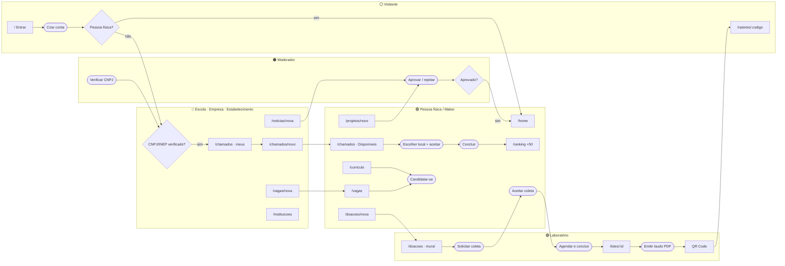
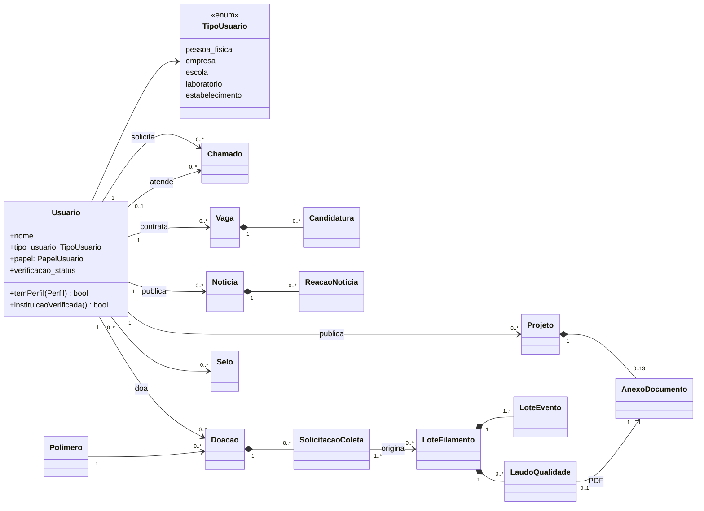

# Diagramas para o Figma — conteúdo pronto para transpor

Este arquivo traz o conteúdo dos três diagramas pedidos, já organizado com os **componentes de cada template**. Basta duplicar o componente indicado e preencher os textos.

| Diagrama | Template | Seção deste arquivo |
| :--- | :--- | :--- |
| Jornada do usuário e fluxo de navegação | [User Flow Diagram Template for FigJam](https://www.figma.com/board/pR035aNZzQtJ6MFpvtuvF0) | [1](#1-user-flow--jornada-e-navegação-com-rbac) |
| Arquitetura do sistema (UML) | [UML Diagrams](https://www.figma.com/board/eqWkYTSakFSjIw95uzFJ5A) | [2](#2-uml--arquitetura-desembaraçada) |
| Banco de dados (DER) | [Database Diagram Builder](https://www.figma.com/design/KSFC7l25Nu0mVDmt6ODcJo) | [3](#3-der--tabelas-antigas-e-novas) |

Cada seção termina com um diagrama Mermaid de apoio, que mostra o resultado esperado e serve para conferir se nenhuma ligação ficou de fora.

---

## 1. User Flow — jornada e navegação com RBAC

### 1.1 Componentes do template usados

| Componente do template | Uso no EcoHub |
| :--- | :--- |
| `Light Mode/Screen` (título) | Tela simples. `text-top-left` = rota; `text-bottom-right` = perfil exigido |
| `Light Mode/Screen` (título + subtítulo) | Tela com estado (ex.: "Painel de chamados / aba Disponíveis") |
| `Light Mode/Screen-stack` | Conjunto de telas parecidas (ex.: os 5 formulários de registro) |
| `Dark Mode/User-action` | Ação do usuário (botão clicado) |
| `Light Mode/Question` + `Answer-yes` / `Answer-no` | Decisão de permissão (RBAC) ou de estado |
| `Light Mode/Tag` | Cor do ator: 🟣 Pessoa física/Maker · 🔵 Escola/Empresa/Estabelecimento · 🟢 Laboratório · 🟠 Moderador · ⚪ Visitante |
| `Light Mode/Description` | Regra de negócio em uma frase |
| Texto vertical à esquerda | Raia do ator, como "👨 passenger" no exemplo |
| Texto no topo da coluna | Fase da jornada, como "1. request" no exemplo |

### 1.2 Raias (atores) e fases (colunas)

**Raias, de cima para baixo:**
1. ⚪ Visitante
2. 🟣 Pessoa física / Maker
3. 🔵 Escola · Empresa · Estabelecimento (solicitante)
4. 🟢 Laboratório (receptor e prestador)
5. 🟠 Moderador

**Colunas, da esquerda para a direita:**
1. Acesso
2. Verificação
3. Descoberta
4. Registro
5. Atendimento
6. Resultado

### 1.3 Nós (copie um a um)

| ID | Raia | Fase | Componente | Título | Subtítulo / `text-top-left` | `text-bottom-right` (perfil) |
| :-- | :-- | :-- | :-- | :-- | :-- | :-- |
| V1 | Visitante | 1 | Screen | Entrar | `/` | público |
| V2 | Visitante | 1 | Screen | Criar conta | `/cadastro/usuario` | público |
| V3 | Visitante | 3 | Screen | Rastreio do lote | `/rastreio/:codigo` (QR) | público |
| A1 | Visitante | 1 | User-action | Criar conta | — | — |
| Q1 | Visitante | 2 | Question | Pessoa física? | — | — |
| D1 | Visitante | 2 | Description | "CPF e CNPJ têm dígitos conferidos; escola informa INEP" | — | — |
| P1 | Pessoa física | 3 | Screen | Início | `/home` | autenticado |
| P2 | Pessoa física | 3 | Screen (título+sub) | Vagas | `/vagas` · lista + detalhe | autenticado |
| P3 | Pessoa física | 4 | Screen | Meu currículo | `/curriculo` | candidato |
| P4 | Pessoa física | 5 | User-action | Candidatar-se | — | candidato |
| P5 | Pessoa física | 4 | Screen-stack | Registrar doação | `/doacoes/nova` · peça, sobra, carretel | autenticado (maker) |
| P6 | Pessoa física | 5 | User-action | Aceitar coleta | — | doador |
| P7 | Pessoa física | 3 | Screen (título+sub) | Painel de chamados | `/chamados` · aba Disponíveis | prestador (maker) |
| P8 | Pessoa física | 5 | User-action | Escolher local + aceitar | — | prestador |
| P9 | Pessoa física | 6 | User-action | Concluir atendimento | — | prestador responsável |
| P10 | Pessoa física | 6 | Screen | Ranking e selos | `/ranking` | autenticado |
| P11 | Pessoa física | 4 | Screen | Enviar projeto 3D | `/projetos/novo` · STL/3MF | autenticado |
| Q2 | Escola… | 2 | Question | CNPJ/INEP verificado? | — | — |
| N1 | Escola… | 2 | Answer-no | — | "Conta pendente: navega, doa, envia projeto" | — |
| S1 | Escola… | 3 | Screen (título+sub) | Painel de chamados | `/chamados` · meus pedidos | solicitante |
| S2 | Escola… | 4 | Screen | Novo chamado | `/chamados/novo` | solicitante |
| S3 | Escola… | 5 | Screen | Acompanhar etapas | Aberto → Em atendimento → Resolvido | solicitante |
| S4 | Escola… | 4 | Screen | Publicar vaga | `/vagas/nova` | contratante |
| S5 | Escola… | 4 | Screen | Publicar notícia | `/noticias/nova` · vai para revisão | publicador |
| S6 | Escola… | 3 | Screen | Empresas e instituições | `/instituicoes` | autenticado |
| L1 | Laboratório | 3 | Screen (título+sub) | Doações | `/doacoes` · mural | receptor |
| L2 | Laboratório | 5 | User-action | Solicitar coleta | — | receptor |
| L3 | Laboratório | 5 | User-action | Agendar e concluir (peso real) | — | receptor |
| L4 | Laboratório | 6 | Screen | Lote | `/lotes/:id` · eventos | receptor |
| L5 | Laboratório | 6 | User-action | Emitir laudo (PDF) | — | receptor |
| L6 | Laboratório | 6 | Screen | QR Code do lote | — | público |
| M1 | Moderador | 2 | Screen | Moderação | `/moderacao` | moderador |
| M2 | Moderador | 2 | User-action | Consultar CNPJ (BrasilAPI) e verificar | — | moderador |
| M3 | Moderador | 4 | User-action | Aprovar / rejeitar notícia ou projeto | — | moderador |
| Q3 | Moderador | 4 | Question | Conteúdo aprovado? | — | — |

### 1.4 Conectores (setas)

| De | Para | Rótulo |
| :-- | :-- | :-- |
| V1 | A1 | "Ainda não tem conta?" |
| A1 | Q1 | — |
| Q1 → Answer-yes | P1 | pessoa física entra direto |
| Q1 → Answer-no | Q2 | instituição fica pendente |
| Q2 → Answer-yes | S1 | perfis liberados |
| Q2 → Answer-no | N1 | — |
| M2 | Q2 | moderador decide |
| S1 | S2 | "Novo chamado" (só solicitante) |
| S2 | P7 | chamado aparece em Disponíveis |
| P7 | P8 | local: na instituição, no espaço do prestador ou remoto |
| P8 | S3 | contato liberado às duas partes |
| P8 | P9 | — |
| P9 | P10 | +50 pontos |
| P5 | L1 | doação vai ao mural |
| L1 | L2 | só laboratório verificado (receptor homologado) |
| L2 | P6 | doador aceita ou recusa |
| P6 | L3 | — |
| L3 | L4 | +30 laboratório / +15 doador; lote a partir das coletas |
| L4 | L5 | — |
| L5 | L6 | laudo aprova ou reprova o lote |
| L6 | V3 | QR impresso no carretel |
| S4 | P2 | vaga publicada |
| P2 | P4 | só pessoa física |
| P3 | P4 | — |
| S5 | M3 | entra em revisão |
| P11 | M3 | entra em revisão |
| M3 | Q3 | — |
| Q3 → Answer-yes | P1 | publicado no portal / vitrine |
| Q3 → Answer-no | S5 | volta ao autor com motivo |

### 1.5 Mermaid de apoio

---

## 2. UML — arquitetura desembaraçada

O template **UML Diagrams** tem formas para classe (3 compartimentos), pacote, componente, interface e as setas de associação, composição, generalização e dependência. Monte em **três quadros**, nesta ordem.

### 2.1 Quadro A — Componentes (visão por camadas)

Use **pacotes** empilhados da esquerda para a direita. As setas de **dependência** (tracejadas) apontam sempre para a camada seguinte; não há seta voltando.

| Pacote | Componentes dentro |
| :--- | :--- |
| `«frontend» SPA React` | `AppLayout`, `Nav`, `Footer`, `RequirePerfil`, `AuthContext`, `services/api.js`, `Carrossel`, `RevelarAoRolar`, páginas |
| `«borda» HTTP` | `routes/api.php`, `auth:sanctum`, `throttle`, `GarantePerfil (perfil:*)`, `signed` |
| `«aplicação»` | Controllers (20), FormRequests (10), Rules (4), Policies (13), Resources (14) |
| `«domínio»` | Models (19), Enums (13), `ModeracaoService`, `GamificacaoService`, `ArmazenamentoAnexos`, `VerificarAnexo` |
| `«infra»` | PostgreSQL 16, disco privado, ClamAV, BrasilAPI |

Interfaces (símbolo de "pirulito"):
- `AntivirusScanner`, fornecida por `ClamAvScanner` e `SemAntivirus`;
- `ConsultaCnpj`, fornecida por `BrasilApiConsultaCnpj`.

### 2.2 Quadro B — Classes do domínio

**Classe central `Usuario`.** Use um compartimento por bloco abaixo:
- **Atributos:** `+nome`, `+email`, `+tipo_usuario: TipoUsuario`, `+papel: PapelUsuario`, `+prestador_servico: bool`, `+verificacao_status`, `+pontos_total`.
- **Operações:** `+temPerfil(Perfil): bool`, `+perfis(): array`, `+instituicaoVerificada(): bool`, `+ehModerador(): bool`.

**Enumerações** (classe com o estereótipo `«enum»`):
- `TipoUsuario` { pessoa_fisica, empresa, escola, laboratorio, **estabelecimento** }
- `Perfil` { solicitante, prestador, contratante, candidato, publicador, receptor, moderador }
- `StatusChamado` { Aberto, Em Atendimento, Resolvido, Cancelado }
- `StatusDoacao` { disponivel, reservada, coletada, cancelada }
- `StatusColeta` { pendente, aceita, recusada, agendada, concluida, cancelada }
- `StatusPublicacao` { em_revisao, publicado, rejeitado }

**Associações** (com multiplicidades nas pontas):

| Origem | Destino | Tipo | Multiplicidade | Papel |
| :-- | :-- | :-- | :-- | :-- |
| Usuario | Chamado | associação | 1 — 0..* | solicita |
| Usuario | Chamado | associação | 0..1 — 0..* | atende (prestador) |
| Usuario | Vaga | associação | 1 — 0..* | contrata |
| Vaga | Candidatura | composição ◆ | 1 — 0..* | — |
| Usuario | Candidatura | associação | 1 — 0..* | candidata-se |
| Usuario | Curriculo | associação | 1 — 0..* | mantém |
| Usuario | Noticia | associação | 1 — 0..* | publica |
| Noticia | ReacaoNoticia | composição ◆ | 1 — 0..* | — |
| Usuario | Projeto | associação | 1 — 0..* | publica |
| Projeto | AnexoDocumento | composição ◆ | 1 — 0..13 | STL/3MF/imagens |
| Usuario | Doacao | associação | 1 — 0..* | doa |
| Polimero | Doacao | associação | 1 — 0..* | classifica |
| Doacao | SolicitacaoColeta | composição ◆ | 1 — 0..* | — |
| SolicitacaoColeta | LoteFilamento | associação | 1..* — 0..* | origina (via `lote_origens`) |
| LoteFilamento | LoteEvento | composição ◆ | 1 — 1..* | linha do tempo |
| LoteFilamento | LaudoQualidade | composição ◆ | 1 — 0..* | — |
| LaudoQualidade | AnexoDocumento | associação | 0..1 — 1 | PDF |
| Usuario | Selo | associação | 0..* — 0..* | conquista |
| Usuario | Pontuacao | composição ◆ | 1 — 0..* | — |
| Usuario | Moderacao / Denuncia | associação | 1 — 0..* | decide / denuncia |

Generalização (seta com triângulo vazio):
- `Noticia` e `Projeto` → trait `«trait» Moderavel`;
- `ClamAvScanner` e `SemAntivirus` → `«interface» AntivirusScanner`.

### 2.3 Quadro C — Sequência "aceitar chamado"

Linhas de vida:
1. `Prestador`
2. `SPA`
3. `GarantePerfil`
4. `ChamadoController`
5. `ChamadoPolicy`
6. `PostgreSQL`

Mensagens, na ordem:
1. Prestador → SPA: escolhe local e clica "Aceitar".
2. SPA → GarantePerfil: `POST /api/chamado/{id}/aceitar` (Bearer).
3. GarantePerfil → SPA: 403 se não for prestador.
4. GarantePerfil → ChamadoController: segue.
5. ChamadoController → ChamadoPolicy: `aceitar()`; nega se for o próprio solicitante.
6. ChamadoController → PostgreSQL: `SELECT … FOR UPDATE`.
7. Fragmento **alt**:
   - **[aberto]** UPDATE para Em Atendimento → 200 com o contato;
   - **[já aceito]** 409.

### 2.4 Mermaid de apoio (Quadro B)

---

## 3. DER — tabelas antigas e novas

No **Database Diagram Builder**, cada tabela é um cartão com cabeçalho e linhas `chave · coluna · tipo`. Copie as tabelas abaixo e ligue cada FK à PK de destino (coluna "Referência").

**Cores dos cabeçalhos:**
- 🟣 identidade;
- 🟠 conteúdo;
- 🔵 serviços;
- 🟢 economia circular.

**Origem das tabelas:**
- marcadas como *legado*: vêm do `script.sql` original;
- as demais: criadas pelas migrations.

Colunas `created_at`/`updated_at` omitidas.

> **Empresas e estabelecimentos** não têm tabela própria: são linhas de `usuario` com `tipo_usuario` em (`empresa`, `escola`, `laboratorio`, `estabelecimento`) e `verificacao_status = 'verificado'`. No diagrama, vale desenhar uma **visão** `instituicoes_verificadas` (tracejada) derivada de `usuario`, que é o que a rota `/api/instituicoes` lê.

#### Identidade e instituições

**`usuario`** — legado (script.sql) + colunas novas

| Chave | Coluna | Tipo | Referência |
| :-: | :--- | :--- | :--- |
| PK | `id` | int8 |  |
|  | `nome` | varchar |  |
|  | `telefone` | varchar |  |
|  | `senha` | varchar |  |
|  | `estudante` | bool |  |
|  | `empresa` | bool |  |
|  | `cpf` | varchar |  |
|  | `sexo` | bool |  |
|  | `profissao` | varchar |  |
|  | `cnpj` | varchar |  |
|  | `email` | varchar |  |
|  | `tipo_usuario` | varchar |  |
|  | `prestador_servico` | bool |  |
|  | `papel` | varchar |  |
|  | `codigo_inep` | varchar |  |
|  | `pontos_total` | int4 |  |
|  | `verificacao_status` | varchar |  |
|  | `verificado_em` | timestamptz |  |
| FK | `id_verificador` | int8 | → `usuario.id` |
|  | `motivo_verificacao` | text |  |

**`selos`** — nova

| Chave | Coluna | Tipo | Referência |
| :-: | :--- | :--- | :--- |
| PK | `id` | int8 |  |
|  | `slug` | varchar |  |
|  | `nome` | varchar |  |
|  | `descricao` | varchar |  |
|  | `acao` | varchar |  |
|  | `meta` | int4 |  |

**`selos_usuario`** — nova

| Chave | Coluna | Tipo | Referência |
| :-: | :--- | :--- | :--- |
| PK · FK | `id_usuario` | int8 | → `usuario.id` |
| PK · FK | `id_selo` | int8 | → `selos.id` |
|  | `conquistado_em` | timestamptz |  |

**`pontuacoes`** — nova

| Chave | Coluna | Tipo | Referência |
| :-: | :--- | :--- | :--- |
| PK | `id` | int8 |  |
| FK | `id_usuario` | int8 | → `usuario.id` |
|  | `acao` | varchar |  |
|  | `pontos` | int4 |  |
|  | `origem_type` | varchar |  |
|  | `origem_id` | int8 |  |

#### Conteúdo e curadoria

**`noticias`** — legado (script.sql) + colunas novas

| Chave | Coluna | Tipo | Referência |
| :-: | :--- | :--- | :--- |
| PK | `id` | int8 |  |
| FK | `id_usuario` | int8 | → `usuario.id` |
|  | `titulo` | varchar |  |
|  | `texto` | text |  |
|  | `data_publicacao` | timestamptz |  |
|  | `tema` | varchar |  |
|  | `status` | varchar |  |
|  | `motivo_rejeicao` | text |  |
| FK | `id_moderador` | int8 | → `usuario.id` |
|  | `moderado_em` | timestamptz |  |

**`reacoes_noticias`** — legado (script.sql) + colunas novas

| Chave | Coluna | Tipo | Referência |
| :-: | :--- | :--- | :--- |
| PK | `id` | int8 |  |
| FK | `id_noticia` | int8 | → `noticias.id` |
| FK | `id_usuario` | int8 | → `usuario.id` |
|  | `comentarios` | varchar |  |
|  | `tipo_reacao` | varchar |  |
|  | `data_reacao` | timestamptz |  |

**`projetos`** — legado (script.sql) + colunas novas

| Chave | Coluna | Tipo | Referência |
| :-: | :--- | :--- | :--- |
| PK | `id` | int8 |  |
| FK | `id_usuario` | int8 | → `usuario.id` |
|  | `titulo` | varchar |  |
|  | `tema` | varchar |  |
|  | `empresa` | varchar |  |
|  | `texto` | text |  |
|  | `data_publicacao` | timestamptz |  |
|  | `status` | varchar |  |
|  | `motivo_rejeicao` | text |  |
| FK | `id_moderador` | int8 | → `usuario.id` |
|  | `moderado_em` | timestamptz |  |
|  | `area` | varchar |  |
|  | `licenca` | varchar |  |

**`anexos_documentos`** — legado (script.sql) + colunas novas

| Chave | Coluna | Tipo | Referência |
| :-: | :--- | :--- | :--- |
| PK | `id` | int8 |  |
| FK | `id_usuario` | int8 | → `usuario.id` |
|  | `nome_arquivo` | varchar |  |
|  | `url_arquivo` | text |  |
|  | `tipo_documento` | varchar |  |
|  | `data_envio` | timestamptz |  |
|  | `mime` | varchar |  |
|  | `tamanho_bytes` | int8 |  |
|  | `sha256` | bpchar |  |
|  | `disco` | varchar |  |
|  | `status_verificacao` | varchar |  |
|  | `anexavel_type` | varchar |  |
|  | `anexavel_id` | int8 |  |
|  | `metadados` | json |  |

**`moderacoes`** — nova

| Chave | Coluna | Tipo | Referência |
| :-: | :--- | :--- | :--- |
| PK | `id` | int8 |  |
| FK | `id_moderador` | int8 | → `usuario.id` |
|  | `moderavel_type` | varchar |  |
|  | `moderavel_id` | int8 |  |
|  | `decisao` | varchar |  |
|  | `justificativa` | text |  |

**`denuncias`** — nova

| Chave | Coluna | Tipo | Referência |
| :-: | :--- | :--- | :--- |
| PK | `id` | int8 |  |
| FK | `id_denunciante` | int8 | → `usuario.id` |
|  | `denunciavel_type` | varchar |  |
|  | `denunciavel_id` | int8 |  |
|  | `motivo` | varchar |  |
|  | `descricao` | text |  |
|  | `status` | varchar |  |
| FK | `id_moderador` | int8 | → `usuario.id` |
|  | `resolvida_em` | timestamptz |  |

#### Chamados, vagas e currículos

**`chamados`** — legado (script.sql) + colunas novas

| Chave | Coluna | Tipo | Referência |
| :-: | :--- | :--- | :--- |
| PK | `id` | int8 |  |
| FK | `id_usuario` | int8 | → `usuario.id` |
|  | `titulo` | varchar |  |
|  | `descricao` | text |  |
|  | `data_criacao` | timestamptz |  |
|  | `data_limite` | date |  |
|  | `status` | varchar |  |
|  | `tipo_servico` | varchar |  |
|  | `cidade` | varchar |  |
|  | `uf` | bpchar |  |
| FK | `id_prestador` | int8 | → `usuario.id` |
|  | `local_atendimento` | varchar |  |
|  | `aceito_em` | timestamptz |  |
|  | `concluido_em` | timestamptz |  |

**`vagas`** — legado (script.sql) + colunas novas

| Chave | Coluna | Tipo | Referência |
| :-: | :--- | :--- | :--- |
| PK | `id` | int8 |  |
| FK | `id_usuario` | int8 | → `usuario.id` |
|  | `titulo` | varchar |  |
|  | `tema` | varchar |  |
|  | `cep` | varchar |  |
|  | `cidade` | varchar |  |
|  | `texto` | text |  |
|  | `data_publicacao` | timestamptz |  |

**`candidaturas`** — legado (script.sql) + colunas novas

| Chave | Coluna | Tipo | Referência |
| :-: | :--- | :--- | :--- |
| PK | `id` | int8 |  |
| FK | `id_usuario` | int8 | → `usuario.id` |
| FK | `id_vaga` | int8 | → `vagas.id` |
|  | `status` | varchar |  |
|  | `data_candidatura` | timestamptz |  |

**`curriculo`** — legado (script.sql) + colunas novas

| Chave | Coluna | Tipo | Referência |
| :-: | :--- | :--- | :--- |
| PK | `id` | int8 |  |
| FK | `id_usuario` | int8 | → `usuario.id` |
|  | `cargo` | varchar |  |
|  | `habilidades` | varchar |  |
|  | `competencias` | varchar |  |
|  | `data_inicio` | date |  |
|  | `data_fim` | date |  |
|  | `texto` | text |  |

#### Economia circular (doações → laudo)

**`polimeros`** — nova

| Chave | Coluna | Tipo | Referência |
| :-: | :--- | :--- | :--- |
| PK | `id` | int8 |  |
|  | `sigla` | varchar |  |
|  | `nome` | varchar |  |
|  | `densidade_g_cm3` | numeric |  |
|  | `temp_extrusao_min` | int2 |  |
|  | `temp_extrusao_max` | int2 |  |
|  | `reciclavel` | bool |  |

**`doacoes`** — nova

| Chave | Coluna | Tipo | Referência |
| :-: | :--- | :--- | :--- |
| PK | `id` | int8 |  |
| FK | `id_doador` | int8 | → `usuario.id` |
| FK | `id_polimero` | int8 | → `polimeros.id` |
|  | `tipo` | varchar |  |
|  | `titulo` | varchar |  |
|  | `descricao` | text |  |
|  | `peso_estimado_g` | int4 |  |
|  | `cor` | varchar |  |
|  | `cidade` | varchar |  |
|  | `uf` | bpchar |  |
|  | `latitude` | numeric |  |
|  | `longitude` | numeric |  |
|  | `status` | varchar |  |

**`solicitacoes_coleta`** — nova

| Chave | Coluna | Tipo | Referência |
| :-: | :--- | :--- | :--- |
| PK | `id` | int8 |  |
| FK | `id_doacao` | int8 | → `doacoes.id` |
| FK | `id_laboratorio` | int8 | → `usuario.id` |
|  | `modalidade` | varchar |  |
|  | `status` | varchar |  |
|  | `agendado_para` | timestamptz |  |
|  | `peso_recebido_g` | int4 |  |
|  | `observacoes` | text |  |
|  | `concluida_em` | timestamptz |  |

**`lote_origens`** — nova

| Chave | Coluna | Tipo | Referência |
| :-: | :--- | :--- | :--- |
| PK | `id` | int8 |  |
| FK | `id_lote` | int8 | → `lotes_filamento.id` |
| FK | `id_solicitacao_coleta` | int8 | → `solicitacoes_coleta.id` |
|  | `peso_g` | int4 |  |

**`lotes_filamento`** — nova

| Chave | Coluna | Tipo | Referência |
| :-: | :--- | :--- | :--- |
| PK | `id` | int8 |  |
|  | `codigo` | bpchar |  |
| FK | `id_laboratorio` | int8 | → `usuario.id` |
| FK | `id_polimero` | int8 | → `polimeros.id` |
|  | `peso_entrada_g` | int4 |  |
|  | `peso_saida_g` | int4 |  |
|  | `diametro_nominal_mm` | numeric |  |
|  | `cor` | varchar |  |
|  | `status` | varchar |  |
|  | `produzido_em` | timestamptz |  |

**`lote_eventos`** — nova

| Chave | Coluna | Tipo | Referência |
| :-: | :--- | :--- | :--- |
| PK | `id` | int8 |  |
| FK | `id_lote` | int8 | → `lotes_filamento.id` |
|  | `tipo` | varchar |  |
|  | `descricao` | varchar |  |
|  | `dados` | json |  |
| FK | `id_responsavel` | int8 | → `usuario.id` |
|  | `ocorrido_em` | timestamptz |  |

**`laudos_qualidade`** — nova

| Chave | Coluna | Tipo | Referência |
| :-: | :--- | :--- | :--- |
| PK | `id` | int8 |  |
| FK | `id_lote` | int8 | → `lotes_filamento.id` |
| FK | `id_laboratorio` | int8 | → `usuario.id` |
| FK | `id_responsavel` | int8 | → `usuario.id` |
| FK | `id_anexo` | int8 | → `anexos_documentos.id` |
|  | `diametro_medio_mm` | numeric |  |
|  | `tolerancia_mm` | numeric |  |
|  | `ovalidade_mm` | numeric |  |
|  | `resistencia_tracao_mpa` | numeric |  |
|  | `alongamento_pct` | numeric |  |
|  | `temp_impressao_min` | int2 |  |
|  | `temp_impressao_max` | int2 |  |
|  | `umidade_pct` | numeric |  |
|  | `resultado` | varchar |  |
|  | `observacoes` | text |  |
|  | `emitido_em` | timestamptz |  |

### 3.1 Ligações (para os conectores)

| FK | → PK | Cardinalidade | `ON DELETE` |
| :-- | :-- | :-- | :-- |
| `chamados.id_usuario` | `usuario.id` | N:1 | CASCADE |
| `chamados.id_prestador` | `usuario.id` | N:0..1 | SET NULL |
| `vagas.id_usuario` | `usuario.id` | N:1 | CASCADE |
| `candidaturas.id_vaga` · `candidaturas.id_usuario` | `vagas.id` · `usuario.id` | N:1 | CASCADE |
| `curriculo.id_usuario` | `usuario.id` | N:1 | CASCADE |
| `noticias.id_usuario` · `projetos.id_usuario` | `usuario.id` | N:0..1 | SET NULL |
| `reacoes_noticias.id_noticia` | `noticias.id` | N:1 | CASCADE |
| `doacoes.id_doador` | `usuario.id` | N:1 | CASCADE |
| `doacoes.id_polimero` · `lotes_filamento.id_polimero` | `polimeros.id` | N:1 | NO ACTION (bloqueia excluir polímero em uso) |
| `solicitacoes_coleta.id_doacao` | `doacoes.id` | N:1 | CASCADE |
| `lote_origens.id_lote` · `lote_origens.id_solicitacao_coleta` | `lotes_filamento.id` · `solicitacoes_coleta.id` | N:1 (tabela associativa N:N) | CASCADE |
| `lote_eventos.id_lote` · `laudos_qualidade.id_lote` | `lotes_filamento.id` | N:1 | CASCADE |
| `laudos_qualidade.id_anexo` | `anexos_documentos.id` | N:0..1 | SET NULL |
| `selos_usuario.id_usuario` · `selos_usuario.id_selo` | `usuario.id` · `selos.id` | N:N | CASCADE |
| `anexos_documentos.(anexavel_type, anexavel_id)` | projeto · doação · laudo | polimórfica | — (desenhar tracejada) |

### 3.2 Restrições a anotar ao lado das tabelas

- `usuario`:
  - `chk_tipo_usuario_valido` (5 tipos);
  - `chk_tipo_usuario_documento`;
  - `chk_prestador_pessoa_fisica`;
  - `chk_verificacao_instituicao`;
  - UNIQUE `email` e `codigo_inep`.
- `chamados`:
  - CHECK de status, tipo e local;
  - `id_prestador <> id_usuario`;
  - "em atendimento exige prestador e local".
- `solicitacoes_coleta`: índice único parcial (uma solicitação ativa por doação).
- `lotes_filamento`: UNIQUE `codigo` (ULID) e `peso_saida_g ≤ peso_entrada_g`.
- `pontuacoes`: UNIQUE (usuário, ação, origem).
- `candidaturas`: UNIQUE (vaga, usuário).
